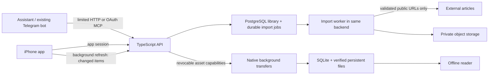

# Architecture

## Server and phone states

Server states retain the existing wire values: queued → processing → ready, or bookmark for a failed submission. Only validated readable content becomes a prepared article. Permanent source/extraction failures stop immediately; transient failures stop after three attempts. The phone shows pending/failed records in a secondary Imports screen, outside the normal Library. Previously prepared copies and all retained submission metadata remain intact. Original URL, title, author when available, references and capture time are retained. Briefs render only supplied text and are labelled agent-created.

Phone states: not downloaded, partial/downloading, text available with incomplete images, or available offline. Presence of server metadata never implies offline readiness. Every file is checked against the manifest's size/hash before commit. Text can be read when images are incomplete. Old content remains installed until replacement text is verified. Local state is independent of connectivity.

## Sync

Each item has a monotonic revision. The phone persists its sync cursor and items in one SQLite transaction. Server tombstones remain visible in sync; offline deletes cannot be resurrected by stale responses. The phone overlays pending edits while applying server metadata. Edit acknowledgements use a local revision so a completed request cannot erase a newer local change. The current app serializes foreground and background sync in one task.

Images and HTML are immutable assets with cryptographic hashes. Download URLs last 24 hours, are bound to an app credential, and are invalidated by logout/revocation or item deletion. A fresh manifest renews expired capabilities. Every native task persists item ID, content version, asset identity and login generation in its task description. Logout clears the generation before cancelling transfers; stale callbacks cannot write into a later session.

## Library completion and device position

The Library shows unarchived prepared items; Archive and Imports are secondary destinations. Queued/processing records are preparation requests, not successful offline saves. Source-image warnings keep readable articles in Library, with incomplete-image status and placeholders. Done reading explicitly sets the existing server read marker (`progress = 1`) and archives the item in one local transaction. Scrolling to the bottom alone never archives. Archiving retains installed content and images.

Actual scroll position is stored separately on the device, preserving it when the server read marker is set and when a completed article is revisited. Cached article metadata shares the article scroll document, so the title leaves the viewport with the body. Saved progress excludes that header, and text-size/theme changes restore the relative body position. This requires no backend schema/API change. The position survives app restart and sync, but remains device-local and is cleared with the local cache on logout.

The latest Done action has a persisted Undo record. Undo restores prior completion/archive fields, merges with newer collection edits, and keeps installed files and the current device position. Later completion/archive/deletion edits or differing synced state invalidate it; old acknowledgements cannot remove a newer Undo patch. Dismissal or another Done action replaces that one-action affordance.

## Import acceptance and retry receipts

Extraction rejects non-success HTTP responses, unsupported types, empty/unusable sanitized text and known challenge/login/error-page signatures. Detection uses diagnostic headings together with directed page instructions, password/challenge markup or short diagnostic content; generic error words in a substantive article do not reject it. These conservative signatures do not guarantee detection of every site's custom block page. Missing optional images produce placeholders and warnings without rejecting readable text.

The additive private `save_requests` table maps operation keys to retained submission IDs and backfills legacy keys without removing rows. Initial creation and explicit recovery register their receipt and queue entry atomically. Replaying any known key never restarts terminal failure. A fresh intent for an owned failed URL requeues the same submission, preventing duplicate articles; manual app Retry uses the retained source URL. Concurrent intents keep distinct receipts but one queue entry. Status and retry retain owner/connection checks; a limited connection cannot inspect or retry another connection's submission. The owner can resolve those opaque duplicates in Imports. No MCP tool names, result fields or status values change.

## Native appearance

Root and modal presentations observe the same stored theme. Light/Sepia explicitly use Light native controls, Dark uses Dark, and System clears the presentation's native override so device appearance can propagate. A small attached UIKit view updates only its containing presentation controller; it does not replace the sheet, navigation stack or fields. Native forms and the library share the Sepia paper/row/ink palette with the cached reader. Overlapping HTML style updates carry the pending body-position target through restoration.

## Browser sharing

The containing app embeds `ReaderShare.appex`. It reads standard URL/text item providers, validates HTTP(S) links and preserves ambiguity until the user chooses a link. The selected signed-in HTTPS Reader destination is displayed before Save. The extension never copies browser cookies or attempts to launch the containing app through unsupported APIs.

An App Group SQLite queue commits the URL and one operation UUID before any request. Its files inherit protected-until-first-authentication data protection and are excluded from backup; bearer credentials live only in a device-only protected shared Keychain item. SQLite transactions and expiring claim tokens serialize app/extension writers. Offline or uncertain responses retain the same operation key. The app drains pending shares during existing foreground/background refresh opportunities; iOS scheduling remains opportunistic.

Queue entries bind owner, server and credential generation. Logout clears the shared queue/profile. Credential rotation on the same account/destination leaves pending links paused for explicit Retry; changing owner/destination removes old links. Late responses cannot acknowledge a newer claim or session. An already-dispatched request may have reached its original server before logout; it is never reassigned to a new account. Reauthentication retains installed cache through `storageId`, while a fresh session generation fences old sync/download callbacks.

Accepted means a server submission, not an offline download. Server failures remain in Imports under the existing policy. Verified main-app assets alone establish offline availability. API credentials are not forwarded through HTTP redirects. App Group membership and the embedded extension have matching signed provisioning; physical Safari/Chrome acceptance remains a release gate.

Apple references: [Share extensions](https://developer.apple.com/library/archive/documentation/General/Conceptual/ExtensibilityPG/Share.html), [App Groups](https://developer.apple.com/documentation/xcode/configuring-app-groups), [shared Keychain access](https://developer.apple.com/documentation/security/sharing-access-to-keychain-items-among-a-collection-of-apps).

## Authentication and authorization

Supabase Auth validates the application's single allowed, confirmed user email. The backend then issues a hashed, revocable app session, stored on-device in Keychain with access after first unlock. An app session lasts 30 days; sign in again after expiry. Development login is local-only and cannot start in production.

The app can read/update/delete its owner's library. API and OAuth credentials can submit and check only that connection's own submissions. Separately, the owner can turn on a per-connection `interests` grant (`connection_grants`, keyed by connection so OAuth refresh keeps it; only an app session can change it; deleted when the connection is revoked in the app or through OAuth revocation, or when its last credential expires). It allows `list_saved_articles`: title, link, site and save time of non-deleted articles, keyset-paged by `(captured_at, id)` with a microsecond-exact cursor. It returns no content, briefs, collections or reading state, so an assistant can learn what the owner saves without reading the library. Deduplicating a save from a different connection returns `already_saved` without revealing another submission ID. All library methods require an app session; restricting MCP tool names alone is insufficient.

The backend is the OAuth authorization server for agents, with Supabase login at its consent form. It supports dynamic public-client registration, exact redirect matching, S256 PKCE, five-minute one-use codes, one-hour agent access tokens, rotated 30-day refresh tokens, browser-bound consent, and revocation. MCP initialization/tool discovery is public; execution requires an agent credential. Tool discovery exposes names/schema only, never library data.

## Fetching and rendering

Fetches accept HTTP(S) without URL credentials or nonstandard ports. Every DNS result must be public; the actual socket is pinned to a validated IP. Redirect targets and image fetches undergo the same checks, preventing DNS rebinding and internal-network fetches. Requests have total deadlines and byte limits. The worker limits article size, element count, image count, input pixels and aggregate image bytes. Supported raster images are transcoded to WebP; SVG and active embeds are excluded.

Readability output passes through DOMPurify; the DOM parser runs neither scripts nor resource loading. Markdown escapes raw HTML. The reader disables content JavaScript, isolates website data, uses CSP, and allows file access only to that article version's directory. Reader-controlled typography/scroll restoration is separate from source content scripts. Links open only after an explicit user tap.

## Boundaries and later work

The stack intentionally has no backend LLM, Redis, separate extraction service or full offline replication framework. Before public signup: introduce schema migration version enforcement, recovery-email flows, abuse quotas with concurrency-safe reservations, a storage/orphan audit, independently reviewed OAuth/security tests, provider logging review, and cross-device conflict policy. The personal beta uses one account and one phone.
