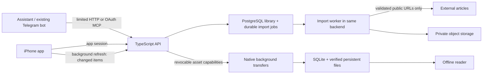

# Architecture

## Server and phone states

Server states: queued → processing → ready, or bookmark with a failure explanation after bounded retries. Original source URL, title, author when available, references and capture time remain in the private library. Briefs render only supplied text and are labelled agent-created.

Phone states: not downloaded, partial/downloading, text available with incomplete images, or available offline. Presence of server metadata never implies offline readiness. Every file is checked against the manifest's size/hash before commit. Text can be read when images are incomplete. Old content remains installed until replacement text is verified. Local state is independent of connectivity.

## Sync

Each item has a monotonic revision. The phone persists its sync cursor and items in one SQLite transaction. Server tombstones remain visible in sync; offline deletes cannot be resurrected by stale responses. The phone overlays pending edits while applying server metadata. Edit acknowledgements use a local revision so a completed request cannot erase a newer local change. The current app serializes foreground and background sync in one task.

Images and HTML are immutable assets with cryptographic hashes. Download URLs last 24 hours, are bound to an app credential, and are invalidated by logout/revocation or item deletion. A fresh manifest renews expired capabilities. Every native task persists item ID, content version, asset identity and login generation in its task description. Logout clears the generation before cancelling transfers; stale callbacks cannot write into a later session.

## Authentication and authorization

Supabase Auth validates the application's single allowed, confirmed user email. The backend then issues a hashed, revocable app session, stored on-device in Keychain with access after first unlock. An app session lasts 30 days; sign in again after expiry. Development login is local-only and cannot start in production.

The app can read/update/delete its owner's library. API and OAuth credentials can submit and check only that connection's own submissions. Deduplicating a save from a different connection returns `already_saved` without revealing another submission ID. All library methods require an app session; restricting MCP tool names alone is insufficient.

The backend is the OAuth authorization server for agents, with Supabase login at its consent form. It supports dynamic public-client registration, exact redirect matching, S256 PKCE, five-minute one-use codes, one-hour agent access tokens, rotated 30-day refresh tokens, browser-bound consent, and revocation. MCP initialization/tool discovery is public; execution requires an agent credential. Tool discovery exposes names/schema only, never library data.

## Fetching and rendering

Fetches accept HTTP(S) without URL credentials or nonstandard ports. Every DNS result must be public; the actual socket is pinned to a validated IP. Redirect targets and image fetches undergo the same checks, preventing DNS rebinding and internal-network fetches. Requests have total deadlines and byte limits. The worker limits article size, element count, image count, input pixels and aggregate image bytes. Supported raster images are transcoded to WebP; SVG and active embeds are excluded.

Readability output passes through DOMPurify; the DOM parser runs neither scripts nor resource loading. Markdown escapes raw HTML. The reader disables content JavaScript, isolates website data, uses CSP, and allows file access only to that article version's directory. Reader-controlled typography/scroll restoration is separate from source content scripts. Links open only after an explicit user tap.

## Boundaries and later work

The stack intentionally has no backend LLM, Redis, separate extraction service or full offline replication framework. Before public signup: introduce schema migration version enforcement, recovery-email flows, abuse quotas with concurrency-safe reservations, a storage/orphan audit, independently reviewed OAuth/security tests, provider logging review, and cross-device conflict policy. The personal beta uses one account and one phone.
