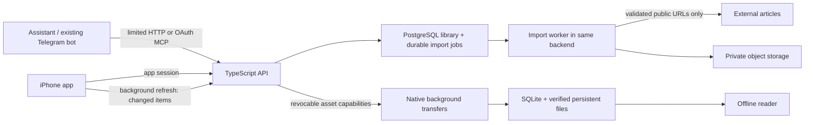

# Architecture

## Server and phone states

Server states retain the existing wire values: queued → processing → ready, or bookmark for a failed submission. Only validated readable content becomes a prepared article. Permanent source/extraction failures stop immediately; transient failures stop after three attempts. The phone shows pending/failed records in a secondary Imports screen, outside the normal Library. Previously prepared copies and all retained submission metadata remain intact. Original URL, title, author when available, references and capture time are retained. Briefs render only supplied text and are labelled agent-created.

Phone states: not downloaded, partial/downloading, text available with incomplete images, or available offline. Presence of server metadata never implies offline readiness. Every file is checked against the manifest's size/hash before commit. Text can be read when images are incomplete. Old content remains installed until replacement text is verified. Local state is independent of connectivity.

## Sync

Each item has a monotonic revision. The phone persists its sync cursor and items in one SQLite transaction. Server tombstones remain visible in sync; offline deletes cannot be resurrected by stale responses. The phone overlays pending edits while applying server metadata. Edit acknowledgements use a local revision so a completed request cannot erase a newer local change. The current app serializes foreground and background sync in one task.

Images and HTML are immutable assets with cryptographic hashes. Download URLs last 24 hours, are bound to an app credential, and are invalidated by logout/revocation or item deletion. A fresh manifest renews expired capabilities. Every native task persists item ID, content version, asset identity and login generation in its task description. Logout clears the generation before cancelling transfers; stale callbacks cannot write into a later session.

## Library completion and device position

The Library shows unarchived prepared items; Archive and Imports are secondary destinations. Queued/processing records are preparation requests, not successful offline saves. Source-image warnings keep readable articles in Library, with incomplete-image status and placeholders. Done reading explicitly sets the existing server read marker (`progress = 1`) and archives the item in one local transaction. Scrolling to the bottom alone never archives. Archiving retains installed content and images.

Actual scroll position is stored separately on the device, preserving it when the server read marker is set and when a completed article is revisited. Cached article metadata shares the article scroll document, so the title leaves the viewport with the body. Saved progress excludes that header, and text-size/theme changes restore the relative body position. This requires no backend schema/API change. The position survives app restart and sync, but remains device-local and is cleared with the local cache on logout.

The latest Done action has a persisted Undo record. Undo restores prior completion/archive fields, merges with newer collection edits, and keeps installed files and the current device position. Later completion/archive/deletion edits or differing synced state invalidate it; old acknowledgements cannot remove a newer Undo patch. Dismissal or another Done action replaces that one-action affordance.

## Import acceptance and retry receipts

Extraction rejects non-success HTTP responses, unsupported types, empty/unusable sanitized text and known challenge/login/error-page signatures. Detection uses diagnostic headings together with directed page instructions, password/challenge markup or short diagnostic content; generic error words in a substantive article do not reject it. These conservative signatures do not guarantee detection of every site's custom block page. Missing optional images produce placeholders and warnings without rejecting readable text.

The additive private `save_requests` table maps operation keys to retained submission IDs and backfills legacy keys without removing rows. Initial creation and explicit recovery register their receipt and queue entry atomically. Replaying any known key never restarts terminal failure. A fresh intent for an owned failed URL requeues the same submission, preventing duplicate articles; manual app Retry uses the retained source URL. Concurrent intents keep distinct receipts but one queue entry. Status and retry retain owner/connection checks; a limited connection cannot inspect or retry another connection's submission. The owner can resolve those opaque duplicates in Imports. No MCP tool names, result fields or status values change.

## Native appearance

Root and modal presentations observe the same stored theme. Light/Sepia explicitly use Light native controls, Dark uses Dark, and System clears the presentation's native override so device appearance can propagate. A small attached UIKit view updates only its containing presentation controller; it does not replace the sheet, navigation stack or fields. Native forms and the library share the Sepia paper/row/ink palette with the cached reader. Overlapping HTML style updates carry the pending body-position target through restoration.

## Browser sharing

The containing app embeds `ReaderShare.appex`. It reads standard URL/text item providers, validates HTTP(S) links and preserves ambiguity until the user chooses a link. The selected signed-in HTTPS Reader destination is displayed before Save. The extension never copies browser cookies or attempts to launch the containing app through unsupported APIs.

An App Group SQLite queue commits the URL and one operation UUID before any request. Its files inherit protected-until-first-authentication data protection and are excluded from backup; bearer credentials live only in a device-only protected shared Keychain item. SQLite transactions and expiring claim tokens serialize app/extension writers. Offline or uncertain responses retain the same operation key. The app drains pending shares during existing foreground/background refresh opportunities; iOS scheduling remains opportunistic.

Queue entries bind owner, server and credential generation. Logout clears the shared queue/profile. Credential rotation on the same account/destination leaves pending links paused for explicit Retry; changing owner/destination removes old links. Late responses cannot acknowledge a newer claim or session. An already-dispatched request may have reached its original server before logout; it is never reassigned to a new account. Reauthentication retains installed cache through `storageId`, while a fresh session generation fences old sync/download callbacks.

Accepted means a server submission, not an offline download. Server failures remain in Imports under the existing policy. Verified main-app assets alone establish offline availability. API credentials are not forwarded through HTTP redirects. App Group membership and the embedded extension have matching signed provisioning; physical Safari/Chrome acceptance remains a release gate.

Apple references: [Share extensions](https://developer.apple.com/library/archive/documentation/General/Conceptual/ExtensibilityPG/Share.html), [App Groups](https://developer.apple.com/documentation/xcode/configuring-app-groups), [shared Keychain access](https://developer.apple.com/documentation/security/sharing-access-to-keychain-items-among-a-collection-of-apps).

## Authentication and authorization

Supabase Auth validates the application's single allowed, confirmed user email. The backend then issues a hashed, revocable app session, stored on-device in Keychain with access after first unlock. An app session lasts 30 days; sign in again after expiry. Development login is local-only and cannot start in production.

The app can read/update/delete its owner's library. API and OAuth credentials can submit and check only that connection's own submissions. Separately, the owner can turn on a per-connection `interests` grant (`connection_grants`, keyed by connection so OAuth refresh keeps it; only an app session can change it; deleted when the connection is revoked in the app or through OAuth revocation, or when its last credential expires). It allows `list_saved_articles`: title, link, site and save time of non-deleted articles, keyset-paged by `(captured_at, id)` with a microsecond-exact cursor. It returns no content, briefs, collections or reading state, so an assistant can learn what the owner saves without reading the library. Deduplicating a save from a different connection returns `already_saved` without revealing another submission ID. All library methods require an app session; restricting MCP tool names alone is insufficient.

The backend is the OAuth authorization server for agents, with Supabase login at its consent form. It supports dynamic public-client registration, exact redirect matching, S256 PKCE, five-minute one-use codes, one-hour agent access tokens, rotated 30-day refresh tokens, browser-bound consent, and revocation. MCP initialization/tool discovery is public; execution requires an agent credential. Tool discovery exposes names/schema only, never library data.

## Fetching and rendering

Fetches accept HTTP(S) without URL credentials or nonstandard ports. Every DNS result must be public; the actual socket is pinned to a validated IP. Redirect targets and image fetches undergo the same checks, preventing DNS rebinding and internal-network fetches. Requests have total deadlines and byte limits. The worker limits article size, element count, image count, input pixels and aggregate image bytes. Supported raster images are transcoded to WebP; SVG and active embeds are excluded.

Readability output passes through DOMPurify; the DOM parser runs neither scripts nor resource loading. Markdown escapes raw HTML. The reader disables content JavaScript, isolates website data, uses CSP, and allows file access only to that article version's directory. Reader-controlled typography/scroll restoration is separate from source content scripts. Links open only after an explicit user tap.

## Reading context

Reading context is written in one of three places. On iPhones with Apple Intelligence it runs on the device for any account. For long articles, if the reader turns it on in Settings and the build carries Apple's entitlement, Apple's Private Cloud Compute model can read the article whole instead. The server path is the owner-gated fallback and is unchanged.

### On the device (primary)

- **Where.** `ios/OfflineReader/AppleModel.swift` is the only code that touches Apple's FoundationModels framework. It is gated three ways. `#if canImport(FoundationModels)` covers CI's Xcode 16.4, whose iOS 18 SDK has no such framework. `#if compiler(>=6.4)` covers symbols that exist only in the iOS 27 SDK (Xcode 27): `PrivateCloudComputeLanguageModel`, `ContextOptions`, `LanguageModelError`, `SystemLanguageModel.Error`, `contextSize` and `tokenCount(for:)`, so the file still compiles with Xcode 26.x. `@available`/`#available` cover the systems: iOS 26 for the on-device model, 26.4 for token counts, 27 for Private Cloud Compute and the new error types. The app supports iOS 17. The linker weak-links the framework, so iOS 17 and 18 launch normally and report `requiresNewerSystem`. On Xcode 27.2 the file was also type-checked with the `canImport` and `compiler` gates forced off, and with a macOS 13 deployment target, to check the gating (tested 12 November 2026; Xcode 16.4 and 26.x themselves weren't available locally). `LocalAI.swift` coordinates jobs. All pure logic is in ReaderCore and covered by `swift test` with scripted fake models: text extraction, chunking, token estimates, history selection, prompts, parsing, reference resolution and the map-reduce pipeline (`LocalModel.swift`, `ArticleText.swift`, `LocalReadingContext.swift`, `ArticleQuestion.swift`, `PrivateCloud.swift`).
- **Provider seam.** Callers depend only on the `LocalLanguageModel` protocol. It has a label stored as the note's `model` (`apple-on-device` or `apple-private-cloud`) and a location (on device or private cloud), so the sheet can say where a note or answer was written. It also has a context window size, tokens reserved for reasoning, availability, an optional real token count, and one-shot `respond` and streaming `stream` calls that each use a fresh session. Budgets are fractions of the provider's window, so the 32K Private Cloud Compute provider gets whole-article calls without other changes.
- **Window and token counts.** Where the SDK has it (Xcode 27), the window is `SystemLanguageModel.contextSize`: back-deployed to return 4,096 before iOS 26.4 (per the SDK interface), and read from the system on 27. It reads 0 while the model is still downloading, which falls back to 4,096. With Xcode 26.x it's the documented 4,096. On iOS 26.4 and later, `tokenCount(for:)` counts a 6,000-character sample of the article. `TokenEstimate.ratio` turns that into a real-per-estimated ratio, clamped to 0.4–1.5, and every input budget is divided by it. Without a count (iOS 26.0–26.3, Private Cloud Compute, Xcode 26.x) the ratio is 1 and the pessimistic estimate stands: three ASCII characters, or one other character, per token. A context overflow still retries smaller.
- **Availability.** `SystemLanguageModel.default.availability` maps to available, device not eligible, Apple Intelligence off or model not ready, plus unsupported device language (`supportsLocale`) and iOS older than 26. The button shows wherever the device could run the model (including while it's off or downloading, so the sheet can say what to do), for server-entitled accounts, or when a note is saved. Generation errors map to plain copy: context overflow, guardrail violation, unsupported language, assets unavailable, rate limit or concurrent request, and refusal. The model uses Apple's `permissiveContentTransformations` guardrails, which are meant for transforming supplied content such as summarizing it.
- **Input.** The downloaded `article.html` as plain text with paragraphs kept, and the finished articles (`progress >= 1` and archived, not deleted or trashed: the server's rule), most recently changed first, excluding the article itself. Each has its title, site and, for the newest 40, a 220-character opening from the local search index.
- **Pipeline.** Budgets: a part gets 90% of the window left after its instructions (200) and answer cap (160). The combining call gets 90% of the window left after its instructions (360) and answer cap (520), minus any reasoning reserve. The history list gets 40% of the combining budget, capped at 60 entries of about 110 tokens. The article goes in whole when it fits the rest. With a 4,096-token window and no token count, that is about 1,740 estimated tokens in one call. Longer articles are split at paragraph, then sentence, then word boundaries into parts of up to about 3,360 estimated tokens, with up to 28 history entries. At most 8 parts are used, spread evenly across very long articles (the note is marked `excerpted`). Each part is condensed to a 70-word note (answer cap 160 tokens), then one call combines the notes with the finished-article list into the note (answer cap 520 tokens). History entries are the best lexical matches for the article first and the rest newest, dropping openings and then the least relevant entries to fit. A context overflow retries the whole plan at 60% and then 35% of the window. A guardrail refusal on one part skips that part; on all parts, or on the combining call, the sheet says the model declined. Measured on 12 November 2026, on a Mac with macOS 27.2.1, Xcode 27.2 and Apple Intelligence turned on but its model still downloading (`modelNotReady` for over 35 minutes): `SystemLanguageModel.default.contextSize` read 0, so the app falls back to 4,096, and `PrivateCloudComputeLanguageModel().contextSize` read 32,768. Not measured: tokens per article, calls and seconds per note, parse success, prompt fit, output quality, guardrail behaviour and question answering. These budgets follow from the window and the estimate. A macOS harness was prepared outside the repository: the real pipeline and the real `AppleOnDeviceModel` over seven synthetic articles (about 500 to 6,000 words, technical and narrative, one with injected instructions), 30 synthetic finished articles, and questions the articles do and don't answer. It hasn't run, because the model never became available.
- **Prompt and answer.** The instructions say the article and titles are untrusted data. Library lines are flattened and clipped. The reply is sectioned plain text (summary, key points, builds on, already covered, new here), parsed leniently. As on the server, finished articles are `R1…Rn`, references resolve only to listed item IDs, repeats are dropped, and text is clipped (summary 1,200 characters, notes 300, points 240, five per list). It renders as plain `Text`.
- **Storage and precedence.** Notes are saved in the local `contexts` table with the item's content version, `historyTotal` (finished articles at the time, for staleness) and the optional `keyPoints` and `excerpted`. They're stored only on the device and never uploaded to PageStash's server. A Private Cloud Compute note is stored the same way. An on-device note for the same content version is never replaced by a server note, whether it arrives by sync or by the sheet's server refresh, whatever its time. Otherwise the newer note wins, and an explicit generation always saves. Regenerate uses the device whenever the model is available.
- **Scheduling.** One job at a time, because the model serves one request. An explicit request joins a quiet run for the same article or replaces one for another. Quiet work covers the article opened in the reader (also when its device note is missing, stale or only a server note) and, while the app is in the foreground, up to three of the newest unread downloaded articles with no note per visit, one at a time with a 2-second gap. It pauses while a Reading Context sheet is open or the app is inactive, skips Low Power Mode and serious thermal states, and never runs in preview mode. An article is tried quietly once per launch, and a quiet failure is shown in the sheet instead of being retried. Quiet work never uses Private Cloud Compute. When the reader allowed it and it's available, quiet work leaves long articles alone, so they're written when the reader opens Reading Context.
- **Questions.** The article is split into passages of about 160 estimated tokens. A BM25-style lexical score picks the best matches for the question (the opening passages when nothing matches), kept in article order. The budget is half the window left after the answer cap (300), the instructions and question (300) and any reasoning reserve: about 1,750 estimated tokens on the device, or about 15,000 on Private Cloud Compute. The model answers from them only and otherwise says "The article doesn't say." The answer streams as it's written (answer cap 300 tokens, clipped to 1,500 characters). Questions aren't stored, and each is answered on its own. An overflow retries with 30% of the window.

### Apple's Private Cloud Compute (optional, long articles)

- **Policy** (`PrivateCloudPolicy` in ReaderCore). The on-device model is the default. It's also the only path when offline, when Private Cloud Compute is unavailable or not entitled, when today's limit is reached, on iOS 26, for short articles, and for quiet pre-generation. Private Cloud Compute is used only when three things hold. The reader turned on **Use Apple's Private Cloud for Long Articles** in Settings (`UserDefaults` key `privateCloudForLongArticles`, off by default). The model reports available and below its limit. And the article is long: one the on-device plan would have to split into parts (above its direct budget, using the calibrated ratio). Then the whole article goes in one call to the 32K window (up to about 20,000 estimated tokens of article with 60 history entries; longer ones are split into large parts). Questions about an article larger than the on-device passage budget are answered there from many more passages.
- **Fallback.** Any failure of the cloud call falls back to the on-device pipeline: no connection or timeout, the daily limit (`PrivateCloudComputeLanguageModel.Error.quotaLimitReached`), rate limiting (`LanguageModelError.rateLimited`, which Apple's forums report also appearing at the daily limit), service unavailable, overflow, guardrail or refusal. Cancellation doesn't fall back. The sheet then says the note was written on the iPhone and why, for example "Today's Apple Private Cloud Compute limit is used up, so this was written on your iPhone, in parts." It no longer says "nothing was sent anywhere", because the cloud request may have gone out. A question falls back to the device if the cloud fails before any text arrives.
- **Reasoning.** `ContextOptions(reasoningLevel: .light)`: condensing supplied text needs little reasoning, and light reasoning keeps latency and reasoning tokens (which count against the window) low. Apple suggests evaluating from `.moderate`; this choice is untested. 2,048 tokens are reserved: set aside from every budget and added to every answer cap (`maximumResponseTokens`), in case reasoning counts against that cap. Whether it does is unverified.
- **Labels and privacy copy.** Notes are labelled `apple-private-cloud` (or `apple-on-device`). The sheet footer says "Written by Apple's Private Cloud Compute, which received the article's text and the titles and openings of your finished articles." A cloud answer is marked "Answered by Apple's Private Cloud Compute." The empty-state and question footers mention the private cloud only when the setting is on. Settings explains what is sent and when: only when the reader opens Reading Context or asks a question.
- **Default off, and why.** It sends article text and reading history off the iPhone, and the feature shipped promising nothing was sent anywhere. It also uses a per-person daily allowance tied to the reader's iCloud account. So it is opt-in. In builds without the entitlement the switch is disabled and says "Not available in this version of PageStash yet."
- **Entitlement.** The model needs Apple's managed entitlement `com.apple.developer.private-cloud-compute`. The key is from Apple's developer forums and appears as a string in macOS 27.2.1's system frameworks. A developer forum report says the framework reports a missing entitlement when the model is constructed; it doesn't say whether that traps. iOS has no public API for reading an app's own entitlements, so `CodeSignature` in ReaderCore reads them from the app executable's embedded code signature (`LC_CODE_SIGNATURE`, entitlements blob). PageStash constructs the model only when the key is present. Unsigned and simulator builds read as not entitled. The parser is unit-tested on synthetic Mach-O files. It was checked against real signed binaries on macOS 27.2.1 (a universal system app's entitlements, and an ad-hoc signed tool). The repository adds no entitlement, capability or signing change.
- **What the owner must do to enable it.** From Apple's [Accessing Private Cloud Compute](https://developer.apple.com/private-cloud-compute/) page and [Adding server-side intelligence with Private Cloud Compute](https://developer.apple.com/documentation/foundationmodels/adding-server-side-intelligence-with-private-cloud-compute):
  1. Enrol in the [App Store Small Business Program](https://developer.apple.com/app-store/small-business-program/) (the Account Holder applies from that page). Eligibility also needs fewer than 2 million first-time App Store downloads across the developer's apps. If either stops holding, Apple notifies the developer, who must migrate within 6 months.
  2. Request the entitlement with Apple's [Private Cloud Compute request form](https://developer.apple.com/contact/request/private-cloud-compute/), as the Account Holder. An Apple staff answer in the developer forums says it isn't under the App ID's Capability Requests tab. Approval assigns it to the team.
  3. Once assigned, add the Private Cloud Compute capability to the `OfflineReader` target (Xcode's Signing & Capabilities, or the App ID's Capabilities in Certificates, Identifiers & Profiles). This writes `com.apple.developer.private-cloud-compute` into `OfflineReader.entitlements` and the provisioning profiles. It's a signing change for the owner to make, not code.
  4. Test on a physical iPhone with iOS 27 through TestFlight or ad hoc builds (test installs don't count as first-time downloads). Per Apple's forums, Private Cloud Compute doesn't work in the Simulator. Xcode's scheme option *Simulated Apple Foundation Models Availability* can simulate approaching or reaching the limit (reported not to affect PCC on macOS).
  5. Cost: none for eligible Small Business Program developers. Apple says expanded access will cost a fee later, and usage is subject to daily per-person limits that vary.
- **Not tested.** No Private Cloud Compute call has succeeded: this Mac's build has no entitlement. On macOS 27.2.1 with Apple Intelligence still downloading, an unentitled tool could construct the model without a crash. It reported `availability == .unavailable(.systemNotReady)`, `contextSize == 32,768` and the quota below its limit. Its `respond` threw `SystemLanguageModel.Error` ("The model is not available"), which PageStash maps to unavailable. Output quality, latency, reasoning-token use, quota handling and the iOS behaviour without the entitlement are all untested.

### On the server (owner fallback)

The one model call in the system, gated to the owner (or an account with a `reading_context` row in `account_entitlements`) and off unless `OPENROUTER_API_KEY` is set. `GET /v1/features` tells the app whether to show it. `GET /v1/items/:id/context` returns a saved note. `POST /v1/items/:id/context` generates one only when there is none for the current content version, or when `regenerate` is set. All three need an app session; agent credentials are refused.

- **Background.** A second worker loop writes missing notes for the owner's ready articles (not briefs), newest first, one at a time. Accounts that have only an entitlement row get notes when they ask, until there is an explicit opt-in for automatic sending. The loop covers new saves (an import that publishes content wakes it) and the backfill of older articles. After each note it waits 5 seconds, and when there's nothing to do it checks every 10 minutes.
- **Failures.**
  - An item-specific failure (an empty, cut-off or invalid answer, a 400, or no readable text) backs off an hour per attempt (`context_failures`, per content version). After three attempts the item waits for the owner's **Generate Now**.
  - A provider-wide failure first doesn't count against the item: a refused key or credit (401, 402), a rate limit (408, 429), a 5xx, a timeout or a network error. Instead, all background work pauses for 15 minutes, doubling to an hour, and a success resets the pause. A 403 is usually moderation or a guardrail, so it counts per item.
  - If the same article fails provider-wide again after a pause with no success in between, the failure also counts as one of its attempts. A stuck article therefore stops after three, and older ones get their turn. During a long outage this uses up a few articles' attempts each hour or two, and those wait for **Generate Now**. The pause and the in-flight map are in memory, which assumes the single replica the deployment uses.
- **Sync.** Saving a note bumps its item's sync revision but keeps `items.activity_revision`, so the finished-article history (ordered by `COALESCE(activity_revision, revision)`) and staleness don't change. Owner edits and new content clear it. `GET /v1/library` attaches `reading_context` to each item whose note matches its content version, built in a few queries per page. The phone moves it into its local note table, keeping a newer one, or any on-device note for the same content.

- **Input.** Up to 24,000 characters of the item's stored reader HTML, as text, plus the owner's items marked Done (`progress >= 1` and archived, since scrolling to the end alone also syncs progress 1), not deleted or in Trash, the 200 with the most recent activity (`COALESCE(activity_revision, revision)`). Titles and sites are clipped per line. The 40 most recent also get a 400-character opening, cached in `item_excerpts` per content version so a request reads few stored files. Another account's items are never included.
- **Call.** One OpenRouter chat completion (`READING_CONTEXT_MODEL`, default `google/gemini-3.8-flash`) with JSON output, `provider.data_collection = deny`, low reasoning effort with reasoning excluded from the reply, and an output cap of `READING_CONTEXT_MAX_TOKENS` (default 16,000), which reasoning counts against. Only generated tokens are billed, so the generous cap costs nothing unless it's used. It's there to stop runaways and can be brought down once usage shows what notes need. Near a zero balance, OpenRouter can refuse a request whose cap the remaining credit wouldn't cover (402).
- **Prompt and answer.** The prompt marks the article and titles as untrusted data. Finished items are listed as `R1…Rn`. The answer is validated, references outside that list are dropped, and text fields are clipped.
- **Usage.** OpenRouter returns usage on every response. Every saved note stores it in `reading_contexts.usage`: prompt, completion and reasoning tokens, the reported cost (OpenRouter credits, one per US dollar), and the finish reason. Each generation also logs a "Reading context generated" line with those numbers only. To size the cap, look at the completion tokens of recent notes, for example `SELECT max((usage->>'completion_tokens')::int), avg((usage->>'completion_tokens')::int), sum((usage->>'cost')::numeric) FROM reading_contexts WHERE generated_at > now() - interval '7 days'`. A call that hits the 60-second timeout is billed but returns no usage, so it doesn't appear there; look for `timeout` in the failure log.
- **Failure log.** Each failure logs one line with a fixed category (`network`, `timeout`, `bad_body`, `provider_error`, `empty_answer`, `truncated` or `invalid_answer`), the HTTP status, OpenRouter's error code or the clipped finish reason, whether it was billed, and the usage numbers when the provider returned them. It never logs a provider message, prompt or article text.
- **Cost guard.** A generation reserves one unit in `context_usage` (per account, per UTC day) atomically before calling the provider. Background generations use the `background` column and its own limit (`READING_CONTEXT_BACKGROUND_DAILY_LIMIT`, default 300; 0 turns background work off), so a backfill never uses up the owner's own taps. Only a call the provider can't have billed gives its unit back: a refused connection, or a non-2xx before generation. An empty or cut-off answer, a 200 with an error, a timeout or an invalid answer keeps it, so the cap bounds spending. If the owner's request joins a background run that stopped at the background cap, it falls back to the owner's own budget. Saved notes don't count. Concurrent requests for one item share a single call.
- **Turning it down.** Once devices write notes locally, the owner can stop background generation with `READING_CONTEXT_BACKGROUND_DAILY_LIMIT=0`. Explicit requests from a device that can't run the on-device model still work. Nothing on the server changed for on-device notes, which are never uploaded.
- **Storage.** `reading_contexts` keeps the latest note per item with its content version, model, and a digest of the finished-item set. A changed set marks the note `stale` without regenerating it. With more than 200 finished items, editing an older one can change the set and mark notes stale too. Deleting an item removes its note and excerpt, and saved notes stop citing it (server and phone). The phone shows its saved copy at once, then refreshes it from the server, which reports staleness. The phone keeps notes in its local SQLite store for the matching content version, and logout clears them with the rest of the cache.

## Siri, Shortcuts and Spotlight

`ArticleEntity` (App Intents) is a saved article whose identifier is the library item ID, the same unique identifier as its Spotlight item. Its query reads only the signed-in local store (or the synthetic preview store): lookup by ID, suggestions (what to read next, then other openable articles) and string search (title words, then the store's full-text index of downloaded text). `LibraryQueries` in ReaderCore holds the ranking and search, so they are unit tested. Intents act through the app's existing paths: `open(_:)` for Open Article, `finishReading(_:)` and its persisted Undo for Mark Done Reading, and the locally saved note for Get Reading Context, which is spoken as AI-generated, respects the server's feature flag and never generates.

Newer APIs are gated so the iOS 17 deployment target and the Xcode 16 SDK still build: `IndexedEntity` conformance and `CSSearchableItem.associateAppEntity` need iOS 18, and the reader's `NSUserActivity.appEntityIdentifier` needs iOS 18.2. That activity has Handoff, search and prediction turned off. The iOS 18 Assistant Schemas were not adopted, because the `books` and `reader` domains model purchased books and paged documents.

Spotlight items carry title, source, author, link and, for downloaded articles, an excerpt: the first 4,000 characters of the store's tag-stripped search text (`LocalStore.searchExcerpts`, tidied by `LibraryQueries.excerpt`). Indexing is incremental (`SpotlightSync` in ReaderCore, unit tested): each indexed article's signature (fields, content version and word count, so a finished download counts as a change) is kept in `UserDefaults`, and a run indexes only new or changed articles, reading only their excerpts off the main actor, and deletes removed ones with `deleteSearchableItems(withIdentifiers:)`. Runs are serialized: one at a time, after a 0.5 s settle, and a request during a run gets one more run over the newest library, so an older run can't put back a trashed or deleted article. Each run also checks the sign-out generation after every wait. Writes are recorded ahead: before a write, its articles are saved under an empty signature, and their real signatures only after it succeeds. A kill during the write, or a failed write, therefore leaves them known, so they are retried or later removed with their donations. A new index version (`v3`) replaces the whole domain once, with the same write-ahead for the full upsert. While the app runs, `SpotlightReindexer` (a `CSSearchableIndexDelegate` on the default index) answers Spotlight's rebuild requests: all items, by resetting the version, or given identifiers, by marking them pending. The next run applies them. Known limit: requests while the app isn't running would need a Core Spotlight index extension, which the app doesn't have; the next reload rewrites only what its record says changed. `IndexedEntity.attributeSet` describes the same fields without the excerpt. In-app actions are donated with `IntentDonationManager` (iOS 16): an article opened in the reader as Open Article (not when an intent opened it, since the system donates intents it runs), Done Reading as Mark Done Reading, and a saved link as Save Link. An article that leaves the index (deleted, trashed, purged or removed by sync) has its donations deleted with `deleteDonations(matching: .entityIdentifier(_:))` (iOS 16). Signing out deletes the donations of every article intent, with the rest of what the system holds about the library.

Mark Done Reading, Get Reading Context, What to Read Next and Save Link set `authenticationPolicy = .requiresAuthentication` (iOS 16; the default `.alwaysAllowed` runs on a locked iPhone): they change the library or speak its titles. Open Article, Continue Reading and Search Library open the app, which needs an unlock anyway. An unnamed article means the reader's article only while a scene is in the foreground (active, or inactive under Siri's interface). With the reader left open in the background, Mark Done Reading names it and asks for confirmation (`requestConfirmation(dialog:)` with the default action name, iOS 18) or, on iOS 17, asks which article; Get Reading Context asks which article.

12 November 2026, iOS 27 SDK (Xcode 27.2). `ArticleSchemas.swift` holds what needs it, inside `#if compiler(>=6.4)` (the Swift that ships with Xcode 27) so Xcode 16.4 in CI compiles none of it:

- **Search Library** (`@AppIntent(schema: .system.searchInApp)`, a `ShowInAppSearchResultsIntent`, `@available(iOS 27.0, *)`) sets a short-lived `LibrarySearch` request. The Library closes its sheets, pushed Archive or Trash and the reader, and shows the term in its search field. Each step records the request it applied, so a Library view recreated within the 15 seconds doesn't apply it again.
- **View annotations.** The reader's container and each Library row carry `appEntityIdentifier(_:)` for their `ArticleEntity`, on iOS 18.4 and later, the modifier's own availability. The article body is a `WKWebView`, so the SwiftUI container is annotated. On older systems or compilers the reader's user activity still names the open article.
- **Not adopted.** `system.open`: a schema type must itself require iOS 27, and App Intents allows only one `OpenIntent` per entity type (the metadata processor rejects two), while Open Article must stay an `OpenIntent` for Spotlight results on iOS 18 to 26. It can replace Open Article's declaration when the deployment target reaches iOS 27. `browser.readingListItem`: it would need a second, iOS 27-only entity type for the same article and a required link that briefs lack, and Apple lists the browser domain as Shortcuts-only. What to Read Next, Get Reading Context, Mark Done Reading, Continue Reading and Save Link match no schema in the SDK. The iOS 18 `system.search` schema (deprecated in iOS 27 for `searchInApp`) is not adopted for iOS 18 to 26. Measured on Xcode 27.2: an iOS 18 `@AppIntent(schema: .system.search)` intent compiles without warnings and the metadata holds it beside Search Library. But Xcode 16.4 has no `AppSchema` and needs the old `@AssistantIntent(schema:)` spelling, which can't be compiled here, and the iOS 18 intent would remain on iOS 27 as a second, deprecated in-app search. `EntityCollection` and `LongRunningIntent` don't apply: queries return at most 20 articles and no intent runs long.

## Boundaries and later work

Apart from the server reading-context call above (and Apple's on-device model on the phone), the stack intentionally has no backend LLM, Redis, separate extraction service or full offline replication framework. Before public signup: introduce schema migration version enforcement, recovery-email flows, abuse quotas with concurrency-safe reservations, a storage/orphan audit, independently reviewed OAuth/security tests, provider logging review, and cross-device conflict policy. The personal beta uses one account and one phone.
