# Validation record

Build date: 6 October 2026. This record separates completed checks from required live/device acceptance. A passing local test is not evidence of iOS scheduling or host compatibility.

## Completed locally

- TypeScript type-check and backend build.
- Native iOS unsigned Debug and Release compilation against Xcode 26.3 / iOS 26.2 SDK, including the bundled privacy manifest and Release HTTPS enforcement.
- Backend PostgreSQL tests: private and mapped IP blocking, sanitization, article/image extraction fixtures, brief import, idempotency, account isolation, restricted credentials, OAuth PKCE/consent/code replay/refresh/revocation, MCP discovery/tool execution/auth challenge, and expired worker lease recovery.
- SQLite tests on macOS: text/image persistence across storage reopen; corrupt downloads rejected; old content retained during incomplete replacement; pending edit acknowledgement race; tombstones reject late downloads; download removal retains bookmarks and pauses auto-download; unsafe filenames rejected.
- Dependency audit after upgrading the image processor: no known vulnerabilities reported at that check.
- Live public extraction smoke check: Wikipedia's “Airplane mode” article captured six images with no missing-image warnings. This verifies real network extraction, not iPhone offline behavior.
- 10 backend tests and 6 Swift storage tests passed. The backend tests include account deletion of referenced and orphaned files.
- Complete live local HTTP smoke passed: sign-in → restricted assistant credential → asynchronous brief import → hash-verified download → reading/collection edit sync. No real account credentials were used.
- GitHub CI passed independently on Linux (backend tests/build/audit) and macOS (Swift storage tests and unsigned iPhone compilation): https://github.com/akhilvuputuri/offline-reader/actions/runs/37459427884

## Provisioning progress

- Private repository created and initial implementation pushed to `akhilvuputuri/offline-reader`.
- User created a healthy Supabase Free project in Tokyo. The original Singapore suggestion is optional; the existing Tokyo project can serve this personal beta.
- Empty private `articles` bucket created with no public access policies.
- User signed into Render. Its GitHub connection requires explicit approval for repository access before deployment can proceed.
- No Render paid service has been provisioned. No Supabase secrets have been transferred to Render or committed to Git.
- No iPhone is connected and no local code-signing identity is present. A simulator runtime is also absent; available disk space is insufficient to casually install a large runtime. The next device acceptance should use the physical iPhone.

### Update: 7 October 2026

- User selected **Northflank Free** for the server, keeping Supabase. The paid Render service draft remains unsubmitted.
- Server worker now wakes on new saves/retries, checks idle queues every minute, and performs expiry cleanup hourly. Added tests for immediate wake-up, a save racing with an empty claim, non-overlapping execution, outage retry, and shutdown.
- Local backend type-check/build and all 13 backend tests passed after the worker change. Native storage code was unchanged.
- Northflank account sign-in, free project/resource limits, repository authorization, runtime secret setup and live deployment remain pending verification.

### Northflank configuration progress

- Free team and `offline-reader` project created in US Central. Free region choices were US Central and London; Asian regions require a paid plan.
- User completed Northflank's required card verification. The project remains on Developer Sandbox.
- GitHub installation is verified as **Only select repositories**, with exactly `akhilvuputuri/offline-reader` selected.
- `reader-api` combined-service draft uses `/backend/Dockerfile`, `/backend` context, one `nf-compute-20` replica (0.2 shared vCPU / 512 MB), manual builds, public HTTP port 8787 and a `/health` readiness probe.
- Approved API keys are populated in the draft's runtime environment, with the TLS session-pooler URI template. No secret values were written to Git or deliverable files.
- Added a separate `DATABASE_PASSWORD` runtime option to safely encode reserved characters into Supabase's URI template. Type-check, build and all 16 backend tests passed.
- User entered the database password and created the free service. The first container build passed but startup failed because Node did not trust Supabase's database CA. Added the official public CA via `NODE_EXTRA_CA_CERTS`, preserving `sslmode=verify-full`; independently verified the pooler's certificate and hostname without credentials.

### Live deployment: 7 October 2026

- Northflank build `eloquent-spirit-8458` deployed commit `f635e40`. One `nf-compute-20` instance is running on the Free team with its HTTP readiness probe passing (200) and zero restarts for the corrected deployment.
- HTTPS origin: `https://p01--reader-api--2sn8tjhm47hb.code.run`.
- `GET /health` returned 200 and `{"ok":true}`, verifying the production PostgreSQL connection and completed startup migrations.
- Anonymous `GET /v1/library` returned 401. OAuth protected-resource discovery returned 200 with the deployed origin; MCP initialize returned 200 and the expected server capabilities.
- GitHub CI passed for the deployed commit: https://github.com/akhilvuputuri/offline-reader/actions/runs/37563016494.
- Personal Supabase application-user creation remains a human handoff. Authenticated ingestion, private asset upload/download and restart recovery on this host remain unverified.

### Additional acceptance work: 7 October 2026

- The end-to-end verification script caught bodyless DELETE requests incorrectly carrying a JSON content type in the iPhone client. Fixed the client request headers; malformed client requests now retain their proper 4xx status instead of appearing as server failures.
- Added a regression covering HTTP credential revocation, session logout, expired download capabilities and retained library items. All 17 backend tests pass.
- `scripts/verify-backend.mjs` passed against an isolated local backend: an MCP-created brief, a public article with six images, eight size/hash-verified files, idempotent retries, agent library rejection and revoked-agent rejection. This is real extraction and local storage, not a Supabase production ingestion test.
- iOS Debug simulator compilation passed after aligning the app's active architecture with its Swift package. An iOS 26.3 simulator runtime is now installed; no new runtime download was needed.
- Final unsigned Release device compilation also passed. Installed and launched the Debug build on the existing iPhone 17 Pro simulator; launch returned a running process, but visual rendering/sign-in remain unverified while the Mac is locked.
- Cellular changes now cancel/requeue requests under the new policy without discarding verified files. Download enqueue operations are serialized, late failures from an old login are ignored, and article version changes restore the saved reading position.
- The deployed origin is prefilled on login. Settings displays its MCP endpoint even without existing connections, with account controls in their own section.
- UI interaction remains blocked while the Mac is locked. No physical iPhone is connected and no local signing identity is available at this check.
- Redeployed commit `4cc6e36` to Northflank Free. The new instance is Running (1/1); live health returned 200, anonymous library access 401, and an empty JSON DELETE request 400. Independent CI passed: https://github.com/akhilvuputuri/offline-reader/actions/runs/37565183768.
- Added simulator compilation to CI; the exact command passes locally without requiring a simulator runtime on the CI runner.

### Offline sync verification: 7 October 2026

- Fixed a manual-download race: full-manifest requests now follow an active incremental sync rather than incorrectly treating it as sufficient. Concurrent retries share that follow-up refresh instead of duplicating it.
- Sync cancellation is isolated by run identity, so a cancelled old login cannot clear a newer login's sync. Added generation/cancellation checks after edit uploads and download enqueueing before acknowledging edits or updating the last-sync state.
- All 14 Swift tests pass. New cases cover coordinated full/incremental syncs, cancellation across logins, recovery after failure, same-size hash corruption, stale-version downloads, sync-page transaction rollback, and offline edits/download pauses surviving a restart.
- Unsigned Release iPhone and Debug simulator builds pass after this change. Backend code and deployment are unchanged.

### Interactive simulator acceptance: 7 October 2026

- The Mac became available for UI interaction. Used an isolated loopback backend and a synthetic development account, with no Supabase service keys or real app password.
- The unsigned simulator initially failed to save its session in Keychain. Rebuilt with normal ad-hoc simulator signing; login and session persistence then passed. Keychain storage was preserved rather than bypassed.
- Submitted Wikipedia's Airplane mode URL through the app. The backend captured six images; the app reached Available offline and rendered text/images. Larger text worked.
- Stopped the loopback backend and confirmed its health endpoint was unreachable. Restarted the app; the library, cached article, images and reading position remained usable. This is a simulator cache/restart check, not physical iPhone airplane-mode or naturally scheduled background execution.
- Body-text search matched handheld; a nonsense query returned no matches. Offline collection and archive edits survived another restart, then reached the local backend with the reading-position edit after reconnection/manual refresh.
- Saved an agent brief through authenticated MCP. It appeared as AGENT BRIEF in the app, rendered as AGENT-CREATED BRIEF with its source reference, and reached Available offline.
- Removing the article download retained the bookmark and displayed Not downloaded. Explicit Download now restored all assets and Available offline.
- Foreground refresh now restarts its shorter import-polling loop immediately when a save introduces pending imports. Updated Xcode-generated scheme metadata and documented simulator signing.
- Apple Account sign-in is now visible in Xcode. No physical iPhone or valid development signing identity was detected; Xcode's empty certificate panel currently shows disabled creation entries. Supabase application-user creation is still pending.
- Apple Developer portal confirms active individual membership and accepted developer agreements. Registered the explicit App ID `com.akhilvuputuri.offlinereader` under team `U44PG44XMJ`; configured that team in the Xcode project and its generator. No additional capabilities were enabled beyond Apple's default App ID settings.
- App Store Connect's apps page displays its navigation but fails to load its Apple-hosted preflight module. Its private app record has not yet been created. No build has been uploaded or submitted for review.
- A later Xcode refresh shows the Mac's Apple Development certificate. Signing-identity metadata checked outside the shell sandbox confirms one valid identity. No private keys were exported. A physical iPhone is still not connected, so device provisioning/installation remain pending.
- Independent CI passed for the simulator acceptance/polling/team configuration commit: https://github.com/akhilvuputuri/offline-reader/actions/runs/37619218742.

### Signed iPhone installation: 7 October 2026

- The iPhone 17 running iOS 27 reports Developer Mode enabled and development services available.
- Xcode registered/provisioned the connected device for the existing app ID. A device-targeted Debug build failed in asset-catalog thinning for iOS 27 with Xcode 26.3; a generic iOS Release build succeeded with the Apple Development identity and device provisioning profile.
- `devicectl` confirmed successful installation of `com.akhilvuputuri.offlinereader` and successful foreground launch on the physical iPhone.
- The installed Release bundle uses the production HTTPS backend, includes the `fetch` background mode, and disallows arbitrary HTTP. The production health endpoint returned 200.
- Production app-user creation/sign-in and physical offline/background acceptance remain pending. Installation/launch success does not establish those behaviors.

### Owner acceptance and appearance: 7–8 October 2026

- The owner reported successful production sign-in and confirmed an article's text and images remained readable on the physical iPhone after enabling Airplane Mode, disabling Wi-Fi, and closing/reopening the app. This is owner-reported device acceptance, not an instrumented device-screen capture.
- Added a persistent Light/Dark/System appearance preference. Light is the default and explicitly uses a white reading background. Styles are applied by the native reader at display time, so existing cached HTML does not require downloading again.
- Signed Release and simulator builds pass. The theme update was successfully installed and launched on the physical iPhone.
- Interactive simulator checks switched the same previously downloaded brief to Dark and back to Light. Both native controls and cached HTML followed the preference; Light rendered black text on a white background. System is also offered in the picker.
- Published a host-neutral MCP/HTTP adapter contract for another implementing agent. Chief Agent was not changed or connected by this task. Live MCP discovery still exposes exactly the three documented save/status tools.

### Pending phone release: Sepia, 8 October 2026

- Added Sepia to the appearance picker, using warm off-white pages, dark brown text and brown links. The reader header and navigation background match the page.
- Release and simulator builds passed. Visually verified the new option on a previously downloaded brief in the simulator.
- Per the owner's request, this update has **not** been installed on the physical iPhone; it is reserved for the next release. The phone retains its Light/Dark/System build.

### Issue 1: library and completion, 8 October 2026

- One Library replaces the Inbox/Offline/Archived segmented navigation; Archive is reachable through Library options. Device download icons distinguish preparing, missing, partial and verified available-offline content.
- Done reading archives and marks read, returns to the library and offers persisted Undo. Archive/restore retain installed assets. Text size is one control; download actions depend on state; connection/account management have secondary settings screens.
- All 22 local Swift storage/sync tests passed, including eight new restart/position/asset-retention, synced Undo, stale Undo, repeated Done, collection-edit and old-acknowledgement cases. Swift syntax and changed-file formatting checks passed.
- An initial local Swift build failed when the Mac ran out of space. Only task-generated build/archive files were removed; the isolated no-index rebuild passed. Full native device/simulator compilation is delegated to existing macOS CI.
- The debug-only `--preview-library` mode creates a new synthetic store, skips Keychain access and all API calls, and schedules no refresh. CI provides a separate preview bundle identifier for safe visual review. Release builds cannot activate this fixture mode.
- Hosted push and PR checks passed on `d5d82e7`, including backend tests/audit, all 22 storage/sync tests, unsigned iPhone and simulator compilation, and the isolated preview build. Interactive iPhone 17 Pro / iOS 26.3 simulator validation passed: Library → options → Archive takes two taps; Done returns to Library with Undo; Undo restores the cached article and its reading progress; reopening/returning retains that position; Archive restoration returns an item to Library. Downloaded, text-only and preparing indicators were visually checked, and the fully downloaded reader offers no redundant Download/Retry action. The screenshots below contain synthetic data only. The physical iPhone is unavailable; no phone installation, live library edit or backend deployment was performed. Server/MCP contracts, refresh scheduling and the separately tracked title/theme/import-policy issues are unchanged.

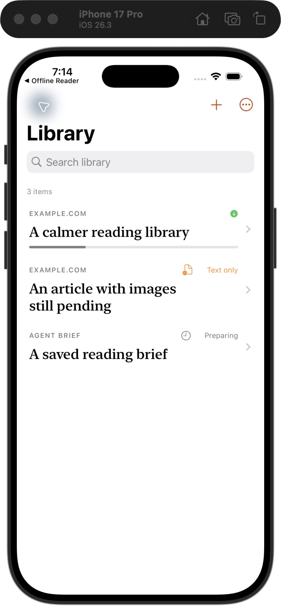

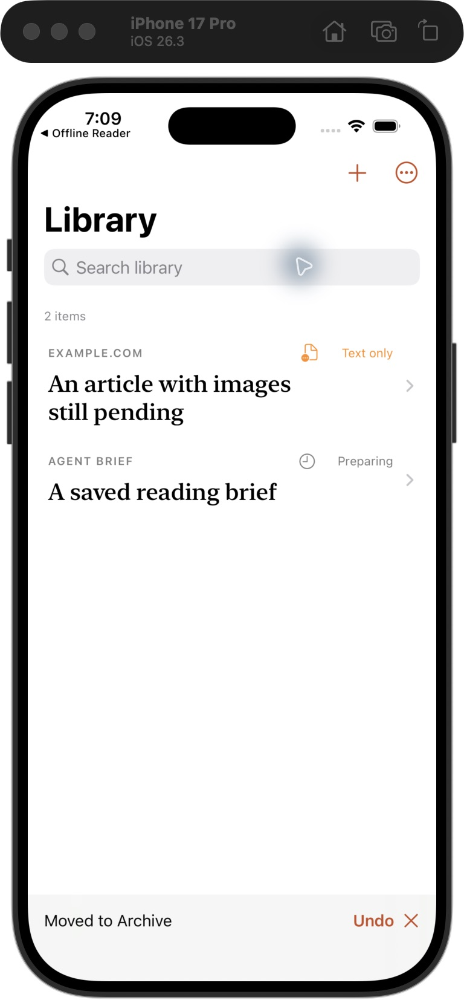

### Issue 2: scrolling article metadata, 8 October 2026

- Cached article title, author, source, offline status and warnings are inserted as text into one header inside the existing WKWebView document. No competing native scroll view wraps cached content; the no-download screen has its own single native ScrollView.
- Exact duplicate leading title headings are removed. Metadata uses JSON and textContent; source links require HTTP(S). Publisher scripts remain disabled and cached files stay immutable.
- Header height is excluded from saved article progress. Presentation/font/theme updates restore the relative body position after styling, with generation checks against stale callbacks.
- All 26 local storage/sync/progress tests pass, including four new header/position geometry cases. Swift syntax, formatting and whitespace checks pass.
- Interactive synthetic simulator checks showed the long title once at the top, then entirely off-screen while scrolling. A quick keyboard-scroll/exit revealed a persistence race; the fix flushes the final position before exiting or finishing. Reopening returned to the same paragraph.
- Larger-text validation moved to an isolated GitHub-hosted simulator while the Mac was locked. Hosted push/PR checks passed on `56b3f96`: all 26 core tests, backend checks, device/simulator compilation, and a native WKWebView regression on iPhone 16 Pro / iOS 18.5. It verifies the scrolling header, preserved publisher text with a matching element ID, 30-point text, dark appearance and retained body progress. The passing synthetic screenshot was visually reviewed. Test launches use a disposable preview store with Keychain/API access bypassed. CI evidence: https://github.com/akhilvuputuri/offline-reader/actions/runs/37781322466.
- A later final CI run exposed an intermittent text-size restoration race: the native scroll content size could still reflect the old font after a fixed delay. Restoration now observes native layout and waits for its measured height to match the styled document. The hosted regression resizes repeatedly between 14 and 30 points. Final checks are linked from https://github.com/akhilvuputuri/offline-reader/pull/11.
- No physical phone update or backend deployment occurred. This change awaits the owner's combined app release.

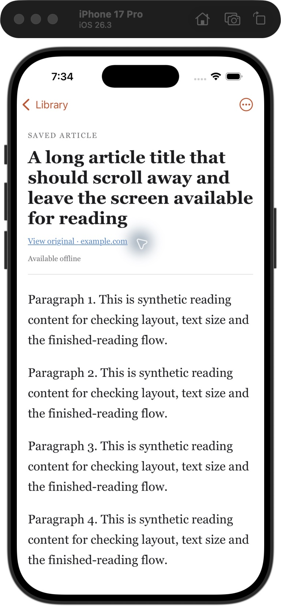

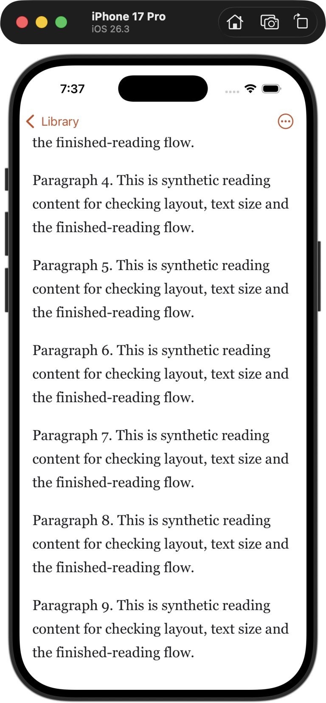

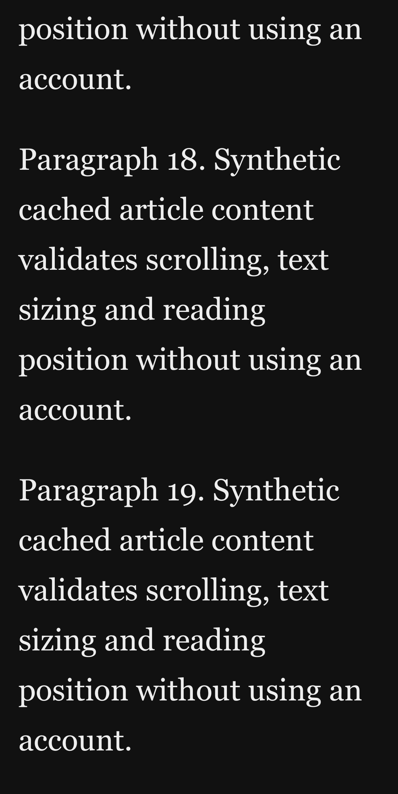

### Issue 3: live settings appearance, 8 October 2026

- The pre-fix hosted iPhone 16 Pro / iOS 18.5 fixture reproduced Light → Dark leaving the open Settings presentation Light: https://github.com/akhilvuputuri/offline-reader/actions/runs/37784486304.
- Theme changes now update the containing presentation's native override, including explicitly clearing it for System. Settings, Save and Text size observe the same preference without changing view identity. Sepia paper, rows, text and navigation colors also apply to native settings and the library.
- Hosted push/PR checks passed on `81c27b4`: backend checks/audit, 26 core tests, device/simulator compilation and two native presentation tests. Settings stays presented across all four choices, retains its form offset, and follows simulated device Light/Dark changes in System mode. Cached HTML backgrounds and reading position follow Light/Dark/Sepia/System. Overlapping style updates previously reset the pending article target; the fix retains it.
- Synthetic Dark/Sepia settings and Sepia Library screenshots were visually reviewed and are retained below and in the test artifact. Final PR checks also cover editing focus and label retention in the connections form. Evidence and final checks: https://github.com/akhilvuputuri/offline-reader/pull/12.
- Physical-iPhone validation remains deferred to the owner's combined app release. No phone installation, live-account modification or backend deployment was performed.

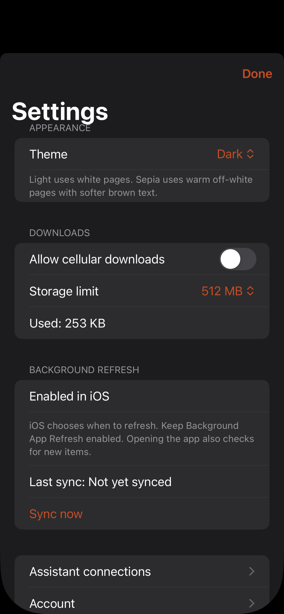

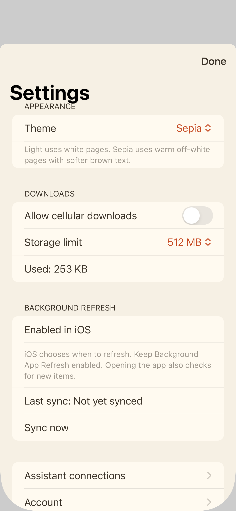

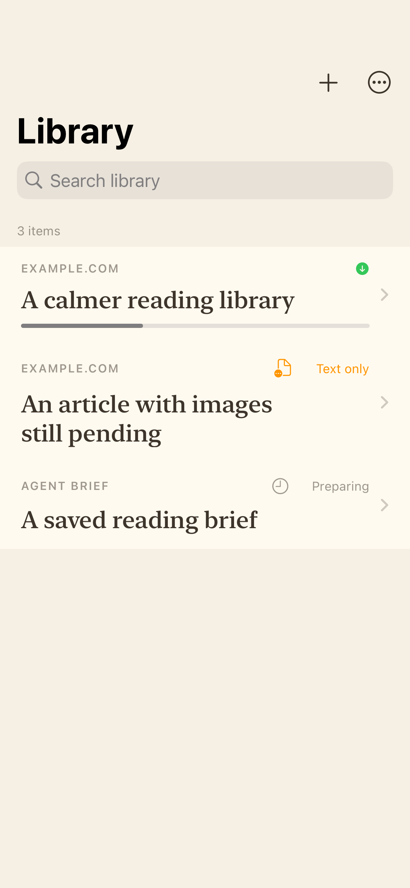

### Issue 4: import acceptance and recovery, 8 October 2026

- Failed/preparing submissions are retained in secondary Imports with a bounded explanation and Retry for article URLs. Normal Library/Archive include prepared articles; previously readable copies remain accessible. Source-image warnings retain readable text and report incomplete images instead of complete offline availability.
- Backend validation rejects non-success HTTP responses, known HTML-200 challenge/login/error-page signatures, unsupported content and unusable sanitized text. Empty rendered Markdown also fails. Positive fixtures retain real reporting about errors, including an ambiguous “Access denied” headline. These signatures are conservative; custom publisher barriers and older captures are not comprehensively audited.
- The additive private `save_requests` table backfills original keys and preserves recovery aliases. Initial registration/recovery and queue entries commit atomically; known-key replays do not restart a failed attempt. Concurrent fresh retries create one queue entry, preserve connection ownership and recover the original submission. No rows are reset or silently deleted. Existing MCP names/result fields/status values remain; `bookmark` is documented as a failed submission, not a readable save.
- All 25 local backend tests, TypeScript check/build and 29 Swift storage/sync/position tests pass. The Swift regressions verify history across restart, promotion of the same submission, readable image placeholders and preservation of old bytes after failed metadata/transfer updates. Hosted push/PR checks passed on `7328f0e`, including backend audit, device/simulator builds and three native presentation tests. The synthetic iPhone 16 Pro / iOS 18.5 Library/Imports screenshots below were visually reviewed. CI: https://github.com/akhilvuputuri/offline-reader/actions/runs/37796650397. Final checks: https://github.com/akhilvuputuri/offline-reader/pull/13.
- App installation, physical-iPhone acceptance and backend/schema deployment remain held for the owner's combined release. The registry is created/backfilled on the future backend startup; no production database was changed in this task.

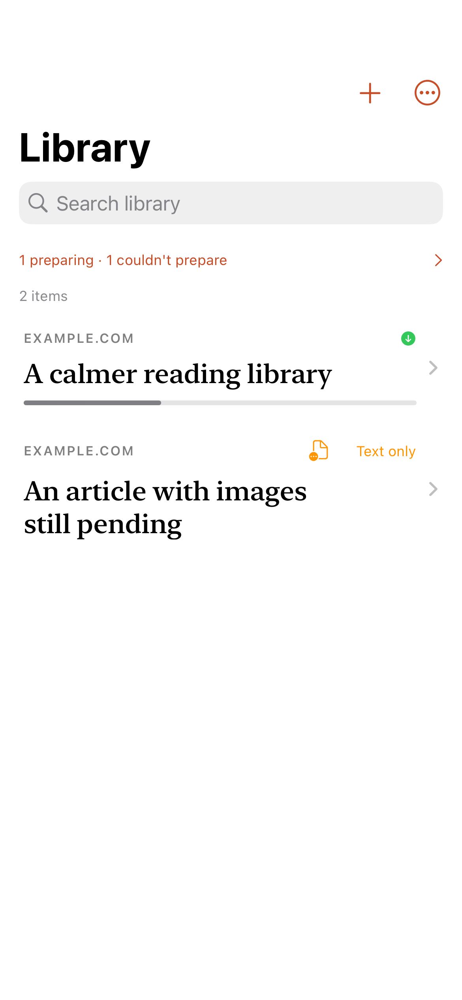

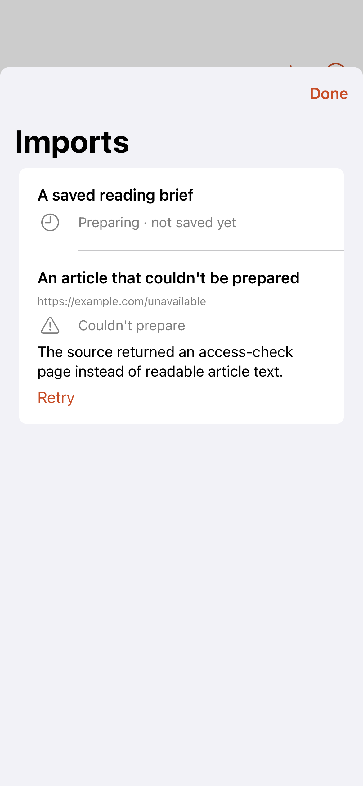

### Issue 5: browser Share Extension, 8–9 October 2026

- Embedded `ReaderShare` receives standard URL/text providers, validates HTTP(S) links and requires a choice for ambiguous input. It displays the selected HTTPS Reader destination before Save. Typed URL loading fixed a hosted regression where standard NSURL providers initially yielded no candidate.
- One durable operation UUID is committed in a protected App Group SQLite queue before submission. Network failures/uncertain responses retain that key. Foreground/background app refresh drains eligible shares; local queue status remains visible even when library refresh fails offline. Accepted/prepared UI never claims a verified offline download.
- Shared credentials use a device-only protected Keychain item. Owner/server/credential generations and expiring claims fence parallel extension/app sends and late responses. Logout clears shared work; reauthentication requires explicit Retry for older same-owner/destination links and keeps installed content through a stable storage ID. API credentials are never forwarded through redirects.
- All 35 local Core/storage tests pass. Native hosted checks passed on `b89c583`: backend audit, device/simulator/isolated-preview compilation and seven presentation tests without skips. Four new native cases cover browser URL providers, ambiguity, offline→online same-key delivery, revocation/stale completion and legacy session compatibility. The synthetic queued/submitted screenshots were visually reviewed. CI: https://github.com/akhilvuputuri/offline-reader/actions/runs/37805745471. Final checks: https://github.com/akhilvuputuri/offline-reader/pull/14.
- Generic signed Release builds passed for the app and embedded extension, including the final implementation. Both signatures and provisioning profiles permit `group.com.akhilvuputuri.offlinereader`. No app installation, distribution, backend deployment or production library save was performed. The Mac's local interactive UI remained unavailable; real Safari/Chrome sharing on the physical iPhone and naturally scheduled background delivery remain acceptance gates for the owner's combined release.

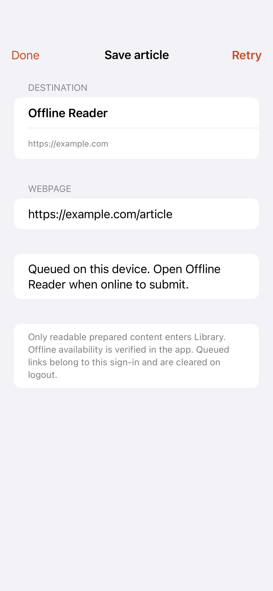

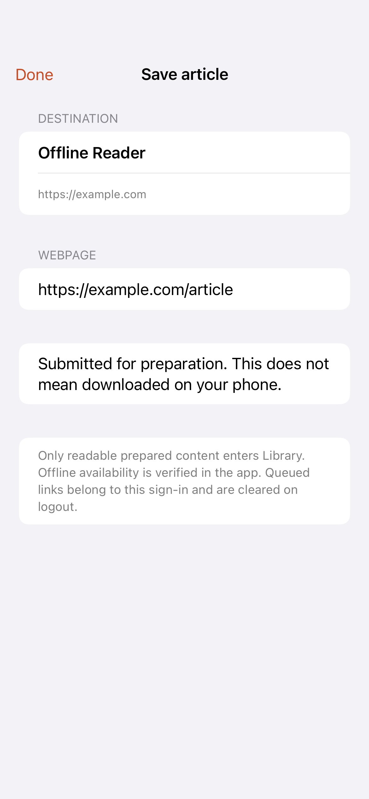

### Reader 0.2.0 shipped: 9 October 2026

- The owner authorized release of issues #1–5 plus the integrated Sepia theme; #6–9 are excluded. Release revision/tag: `89d28a54ad4df80ad6af68ab14f62727159d0e7f`, [v0.2.0](https://github.com/akhilvuputuri/offline-reader/releases/tag/v0.2.0). App and embedded Share Extension are version 0.2.0, build 2.
- Northflank Free manual build `goodly-pump-7224` deployed that exact revision. Service UI showed Running, one instance, 1/1 passing health probes and zero restarts at verification. Live `/health` returned 200 with database health true; anonymous `/v1/library` returned 401; OAuth protected-resource discovery returned 200. Startup completed the additive retry-receipt migration. No production library reset or data deletion was performed.
- Generic signed Release compilation passed. The signed feature tree is identical to the release merge tree. `devicectl` verified successful installation and foreground launch of `com.akhilvuputuri.offlinereader` on the connected, paired iPhone running iOS 27 with Developer Mode enabled. The embedded Share Extension and matching App Group entitlement/profile are included. The app was updated in place, without uninstalling it or clearing its cache.
- Integrated release checks passed: [CI](https://github.com/akhilvuputuri/offline-reader/actions/runs/37810939302), including 25 backend tests/audit, 35 Core/storage tests, seven native presentation tests and device/simulator builds. The public GitHub release contains notes/tag, not a provisioning profile or signed device binary. No TestFlight/App Store distribution was performed.
- The owner confirmed that Sepia updates and a public-article browser share submits correctly on the installed iPhone build. This is owner-reported acceptance, not an instrumented device-screen capture; a real offline-read regression of the new build remains to be confirmed. Naturally scheduled background delivery remains unverified. Installation/launch and public health do not establish those behaviors or authenticated production ingestion.

### Background refresh investigation: 13 October 2026

The owner reported that a browser submission remained unavailable offline after leaving Reader closed while online. Background App Refresh was enabled globally and for Reader. The original missed run has no scheduling/wake trace, so its cause remains unknown.

- Reader 0.2.0 was installed on the connected iPhone. Device diagnostics confirmed refresh permission available, Low Power Mode off, successful task registration and an existing pending refresh request. Live server/database health returned HTTP 200. These checks do not prove a naturally scheduled wake or successful import throughput.
- With the owner's explicit approval, a temporary developer build created one labelled synthetic brief and disabled foreground polling to isolate the background path. Apple's development simulation selector, plus a bounded 30-second UIApplication background execution window, invoked the existing BGAppRefresh handler while the app was in the background. Full sync completed in **8.451 seconds**. The synthetic text asset passed manifest verification and reached available-offline state **10.030 seconds** after the handler started; the verifier recorded UIApplication background state. The brief remains available for inspection. Its test-only local download was cleared for the repeat; no pre-existing user article/cache was reset or deleted.
- An initial simulation without the execution window started but produced neither completion nor expiry while the process appeared suspended. This attempt is inconclusive, not evidence of a server failure. A repeat fixture lookup initially lost its creation event when the bounded history rolled over; the development harness then reused the same known fixture by title/kind and creation-time bounds. No additional brief was created.
- This controlled development test verifies the phone's actual sync/download implementation against the live server when execution time is provided. It does **not** verify iOS choosing to wake Reader, a freshness deadline, or the original incident's cause. Swiping Reader away generally suppresses background relaunch until it is manually opened; an outstanding request does not override that restriction. See [Apple background limits](https://developer.apple.com/forums/thread/685525).
- The private simulation hook and foreground-polling override were removed from the normal source/build. Signed Reader **0.2.0 build 4** was installed in place and launched with normal behavior plus bounded local diagnostics. Sign-in/cache were retained. Post-restoration diagnostics showed probe inactive, successful sync, no download error and another accepted/pending refresh request. No backend deployment, interval setting or push feature changed.
- Three isolated native tests passed for bounded history, code-only errors, logout/relaunch fencing and expiry/completion races. Signed generic device builds and strict Swift formatting checks passed. The development probe, provisioning profiles, device identifiers, credentials and private library data are excluded from this repository and CI artifacts.

### Issues 30–33: design pass with Apple's HIG, 14 October 2026

Applied the `ios-design` skill's audit to the Library, reader, theme and sign-in. Visual checks used the debug-only `--preview-library` synthetic store under the separate preview bundle identifier on the iPhone 17 Pro / iOS 26.3 simulator; no real library, account or network was used.

- **Library (#30).** Archive is the leading full swipe with a success haptic. Delete is trailing, cannot be a full swipe, and asks for confirmation, because a delete tombstone cannot be undone locally. Each row has a context menu with Archive, Add to Collection, Remove Download and Delete. Rows show the title, one quiet `source · author` line (lower case, without `www.`), and only an exceptional status. The read checkmark and green offline symbol are gone; the disclosure chevron stays. The item count and sync spinner were removed. Imports moved to a row at the end of the list (identifier `Review imports` kept) and to the ⋯ menu with a count. Archive is now a pushed screen with the standard Back button. Observed: a full trailing swipe only reveals Delete; a full leading swipe in Archive moved the item to Library.
- **Dynamic Type (#31).** Row and reader titles scale (`@ScaledMetric`, same default sizes). The article body is the reader's size setting scaled by `UIFontMetrics(.body)`, so the default is unchanged (20 px) and AX5 reaches about 62 px. At accessibility sizes, headings converge toward the body and status text is not truncated. Observed at default and AX5 in Light and Sepia.
- **Contrast (#31).** Theme colours live in one `ThemeTokens` type with Increase Contrast variants; native views and the HTML read the same values (CSS custom properties). A unit test enforces at least 4.5:1 for every ink on its page and surface. Ratios (normal / Increase Contrast):
  - Light on `#ffffff`: secondary 5.23 / 9.12, link 6.15 / 9.02 (was 3.87), accent 4.65 / 6.92, warning 5.35 / 7.80, ink 17.01 / 21.00.
  - Sepia on `#f6f0e4` (row surface `#fffaf0`): secondary 5.55 / 8.36 (6.05 on rows; was about 2.5), link and accent 5.73 / 8.05, warning 4.71 / 6.87, ink 10.62 / 14.40.
  - Dark on `#111111`: secondary 6.74 / 11.21, link 8.96 / 11.80, accent 6.14 / 8.58 (the old rust accent was 4.06), warning 10.59 / 12.77, ink 16.28 / 18.88.
  Light secondary text previously used the system secondary label (about 3.4:1 on white).
- **Reader (#32).** A bottom bar holds `Aa` and Done Reading (Move to Library or Archive when finishing does not apply). Done Reading also appears at the end of the article; it uses the same flush, Undo and dismissal. `Aa` opens a sheet with a grabber, medium/large detents and the standard Close button, holding relative text size and the theme; changes apply live and kept the reading position. The ⋯ menu keeps the less frequent actions. Body text uses New York (`ui-serif`, Georgia fallback), line-height 1.6, a 36em measure, hyphenation, `text-wrap: pretty` and `dir="auto"`. The header drops "SAVED ARTICLE" and the normal "Available offline" line; agent briefs keep their label and add a short "may contain errors" note. Opening an article uses the iOS 18+ zoom transition.
- **iOS 26 conventions (#33).** Custom navigation-bar backgrounds were removed so Liquid Glass and the scroll edge effect apply. The Undo/status bar uses `safeAreaBar` on iOS 26 and sits above the bottom search field. Toolbar symbols are borderless (`ellipsis`). Settings, Imports and `Aa` use the standard Close button on iOS 26. Sign-in leads with email and password; the backend URL is under Advanced and opens automatically when none is stored.
- 13 native tests (10 existing plus 3 token/source tests), 35 Core tests and the unsigned device build pass locally.
- Synthetic screenshots from the preview build:

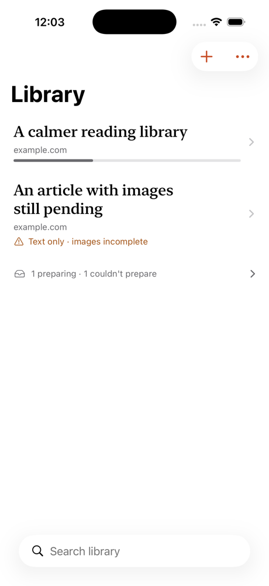
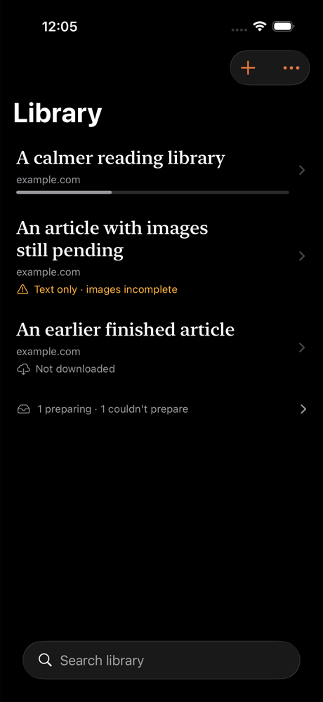
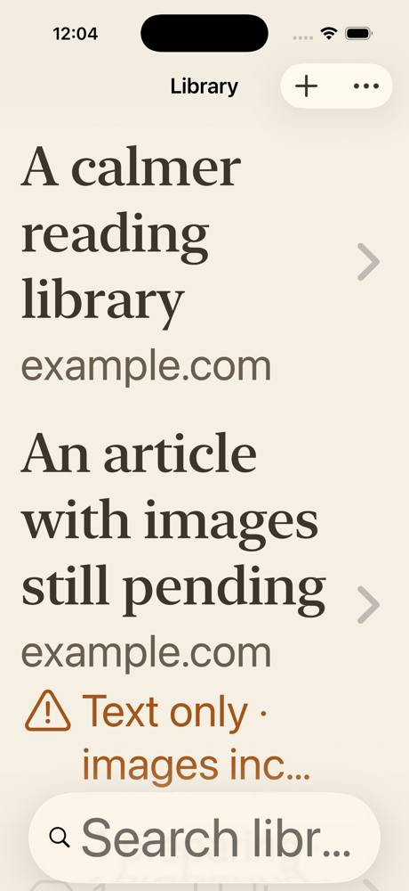
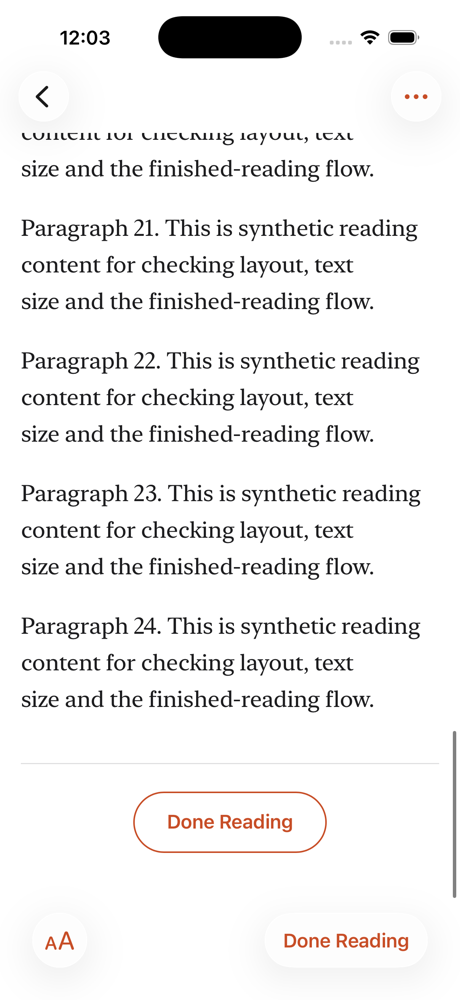
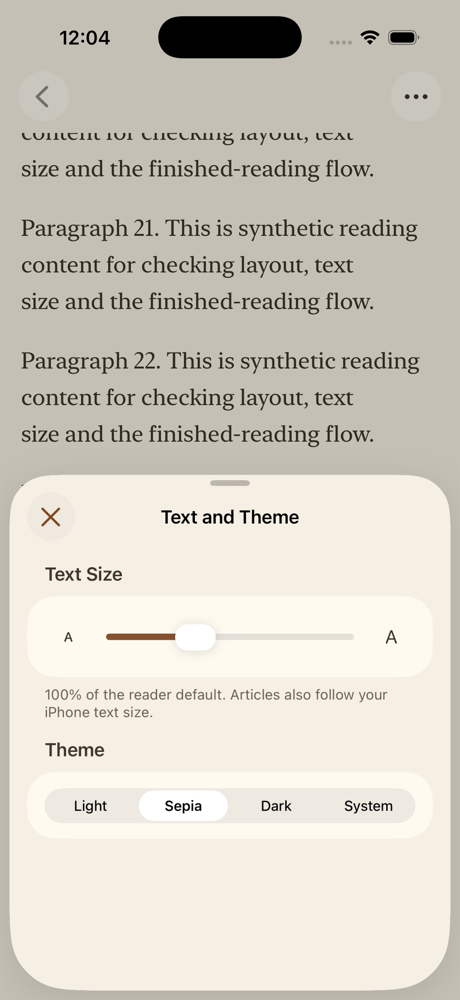

- Not changed, for the owner to decide: the theme still applies to the whole app and defaults to Light (#33 proposes following the system outside the reader). Not done: reading time and site names (need a backend word count and `og:site_name`), receding bars while reading, optional paging, and shake-to-undo. Not checked: VoiceOver with the screen reader running, Reduce Transparency, the smallest iPhone, and the signed-out sign-in screen.

### Reader 0.3.0 follow-ups, 14 October 2026

The items left open in the 0.3.0 design pass. Checked with the synthetic preview store on the iPhone 17 Pro / iOS 26.3 simulator; no real library or network was used.

- **Theme default (#33).** The owner chose System as the default, so the app follows the iPhone's light/dark setting until someone picks Light, Sepia or Dark. A stored choice is kept, and the theme still applies to the whole app.
- **Reading time (#30).** When an article's text is installed, the app counts its words from the plain text it already indexes for search; nothing parses HTML while the list draws. Articles downloaded before this update are counted once from the existing index. Rows show "N min" (about 230 words a minute), or "N min left" for partly read articles. Observed: "2 min left" on a 35%-read article.
- **Site names (#30).** The backend now stores Readability's `siteName` (`og:site_name`) in an additive `items.site_name` column and syncs it. The app shows it in place of the host and falls back to the host when it is missing. **Production needs a manual Northflank deploy** for new saves to carry site names; until then the app keeps showing hosts. Existing articles keep the host unless re-imported.
- **Receding bars (#32).** Bars hide when reading downward and return when scrolling up, on a tap, and near the top or end of the article. The article runs beneath the bars and is padded by their measured height, so hiding them does not move the text. Observed: the bars hid, the status bar area stayed covered with the page colour, and a tap restored the bars with the text in place. With Reduce Motion on, the bars change without animation (not tested).
- **Page by Page (#32).** An option in `Aa`. Each swipe moves one screen less one line, so the last line stays in view. Observed: one short swipe advanced a page with overlap.
- **Shake to undo.** Archive, Move to Library and Done Reading register with the window's undo manager, named after the action. Not exercised: the simulator tool cannot shake.
- **Sync progress.** Settings → Sync now and the Library's Retry show progress while a sync they started is running. Background sync still shows nothing.
- **Tests.** Added coverage for word counts (install, backfill, delete), optional `site_name` decoding, reading-time formatting, site-name preference, and position restore across a Dynamic Type change. Local results: 15 native tests, 37 Core tests and 25 backend tests pass.

### Reader 0.3.0 and 0.3.1 shipped, 14 October 2026

- [Reader 0.3.0](https://github.com/akhilvuputuri/offline-reader/releases/tag/v0.3.0) (build 5) was released from `463dc01` (PR #38). [Reader 0.3.1](https://github.com/akhilvuputuri/offline-reader/releases/tag/v0.3.1) (build 6) was released from `7877e6b` (PR #39). CI passed backend, Core, native presentation and compilation checks for both. Each PR had an independent code review before merge; no high-severity findings.
- Northflank Free manual build `different-cook-9865` deployed `7877e6b` to `reader-api`. The service showed Running, one instance, 1/1 passing health probes and zero restarts. Live `/health` returned 200, anonymous `/v1/library` returned 401, and OAuth protected-resource discovery returned 200. The additive `items.site_name` migration runs before the server listens, so a clean start with passing probes indicates it applied. The only backend change since `89d28a5` is that migration and site-name capture. No production data was reset or deleted.
- Not yet observed: a newly saved production article carrying a site name, the 0.3.x app on the physical iPhone, and TestFlight distribution.

### Closing issues 30–34 and 36, 14 October 2026

Checks used the synthetic preview store on the iPhone 17 Pro and the iPhone 16e (the smallest installed runtime, 390 pt wide; no iPhone SE runtime is installed), iOS 26.3.

- **App icon (#34, part 1).** `scripts/draw-icon.swift` drew through AppKit into a bitmap without alpha, which produced an all-black PNG. It now renders opaque RGB with CoreGraphics. `scripts/check-icon.swift`, run in CI, fails on a wrong size, an alpha channel, or a blank icon; it rejected the old PNG and accepts the new one. Observed: the new build shows the terracotta icon on the Home Screen and in Spotlight, while older simulator installs remain black. The name and a layered Icon Composer icon still need the owner's decision.
- **Reading theme scope (#33).** The chosen theme now styles only the reader, presented full screen, and its `Aa` sheet. The Library, Settings, Imports and sign-in follow the system light/dark setting. Observed: with Dark chosen and the system in Light, the reader and its bars were dark, while Settings and the Library stayed light. Updated tests assert both behaviours. Opening an article now uses a zoom transition from the row into a full-screen presentation, with the standard Close button; an edge swipe also dismisses it.
- **iOS 26 chrome (#33).** `+` and `⋯` sit in separate glass groups (`ToolbarSpacer`, compiled only with the iOS 26 SDK). Section headers use title case.
- **Reader (#32).** Agent briefs list up to five cited sources in the header. With Reduce Motion on, the bars no longer recede on their own; a tap toggles them without animation. New articles carry the source page's language (`<html lang>`), validated against a BCP 47 pattern, so hyphenation applies. Already-downloaded articles gain it only when re-prepared.
- **Accessibility (#31).** Article text honours Bold Text (weight 600), with a regression test that position is kept. On the iPhone 16e at xxxLarge with Increase Contrast on, the Library and reader showed no clipping or truncated titles, and the warning used its high-contrast colour. Swipe actions were not checked with VoiceOver running; a hosted attempt to read them from the accessibility tree found no custom actions, so that check is left for a device.
- **System integration (#36).**
  - Spotlight indexes downloaded articles by title, source and author. Observed in Spotlight search.
  - A Continue Reading widget (small, medium, Lock Screen rectangular) and Home Screen quick action follow the last opened unfinished article. Observed: both show the article, and both open it in the reader.
  - Deep links `offlinereader://item/<id>` open an article. Observed.
  - App Shortcuts: "Continue reading in Offline Reader" and "Save a link to Offline Reader". These compile and their metadata is generated; they were not run through Siri or the Shortcuts app.
  - Signing out clears the index, widget, quick action and last-opened record.
  - Opening a Spotlight result in the preview app was not verified, because Spotlight launched another local build holding the same synthetic titles.
- **Tests.** 25 backend, 37 Core and 18 native tests pass, and the unsigned device build passes. New tests cover deep links, Continue Reading selection, the App Group snapshot, Bold Text, the reading-theme scope, and the source-language tag.
- **Signing.** The widget is a new extension, `com.akhilvuputuri.offlinereader.widget`, in the same App Group. Automatic provisioning must register it before the next signed device build.

### Reader 0.3.2 released, 14 October 2026

- [Reader 0.3.2](https://github.com/akhilvuputuri/offline-reader/releases/tag/v0.3.2) (build 7) was released from `2263fc4b93d064a99d262bfca4c0f4a163bc6abe`, PR #41's merge commit from PR head `015bc45`. It covers the issues recorded in the section above.
- **Before merge.** CI passed backend, Core and native presentation tests, the icon check, and device, simulator and preview compilation. Reported: PR #41's review comment records an independent review with no high-severity findings, and all seven findings fixed. The comment names no reviewed SHA. The build-7 bump (`015bc45`) was committed alongside the fixes, and no re-review of that final head is recorded.
- **Not done at release** (per the release notes).
  - No physical-iPhone installation and no TestFlight.
  - The widget is a new extension, so the next signed build needs automatic provisioning to register it.
- **No backend deploy recorded.** There is no recorded Northflank deploy of `2263fc4`. Article language tagging takes effect only after one.
- This section was added on 15 October 2026 to close the record gap. It contains only facts from the GitHub Release and PR #41.

### Shared a-stack workflow adopted, 14 October 2026

- This repository now follows the a-stack engineering workflow (`workflow@a-stack`, ref `workflow--v0.1.1`). AGENTS.md carries the shared non-negotiable rules and this repository's bindings: checks, reviewer, merge and release authority, Northflank and iPhone release verification, and this file as the record.
- `ios-design` moves from `ios-design--v0.1.0` to the same ref. That ref carries `ios-design` 0.1.1, where the skill content is unchanged and only the a-stack layout moved.
- `.codex/config.toml` enables both plugins for Codex.
- Documentation and configuration only. No app, backend or deployment change. Plugin loading in a trusted Claude Code session and in Codex is not yet observed in this repository.

### PageStash name and icon (#34), 14 October 2026

- **Name.** The owner chose **PageStash**. In exact US App Store title searches, nothing used it. A web product called PageStash exists at pagestash.app (web clipping and archiving), and pagestash.com is registered. The owner accepted that for differentiation. No trademark search was done.
- **What was renamed.** The home-screen name, Share Extension, widget, in-app messages and the OAuth connect page now say PageStash. Bundle identifiers, the project and the `offlinereader://` links keep the original name, so signing, installs and integrations are unaffected.
- **Icon.** Two cream pages tucked into a sleeve, on terracotta, with light, dark and tinted variants in the asset catalog. All three pass `check-icon.swift` in CI.
  - The separate layers are in `design/icon-layers/` for an Icon Composer `.icon` once CI uses Xcode 26; Xcode 16.4 cannot compile `.icon` files.
  - The sign-in screen shows the mark as a rounded tile beside the name.
  - Observed: the PageStash icon and name on the simulator Home Screen.
  - The compiled assets contain the dark and tinted renditions. The simulator Home Screen kept the light icon in dark mode, because the Home Screen icon style is a separate setting the tooling could not switch; check it on the device.
- **Tests.** 25 backend, 37 Core and 18 native tests and the unsigned device build pass. The bundle shows PageStash 0.4.0 (build 8).

### PageStash 0.4.0 shipped, 15 October 2026

- PR #42 conflicted with #43 at first merge. An automation step then published a v0.4.0 release on `6d1d5c5` (without PageStash) and closed #34. Both were reverted within minutes: the release and tag were deleted and #34 was reopened.
- The branch merged `main` and dropped agent commit trailers per AGENTS.md. The independent re-review approved `f735854`. CI passed on it. It was merged with `--match-head-commit` as `ce18a89`, with an identical tree.
- [v0.4.0](https://github.com/akhilvuputuri/PageStash/releases/tag/v0.4.0) is tagged on `ce18a89`. #34 is closed.
- **Backend (tested).** Northflank build `deluxe-support-9320` deployed `ce18a89` to `reader-api`: Running, 1/1 passing probes, 0 restarts. Live `/health` returned 200, anonymous `/v1/library` 401, and OAuth discovery 200. This deploy also brings the 0.3.2 article language tags and the PageStash consent page.
- **iPhone (tested).** A signed Release build of `32bbd6a` (app code identical to `ce18a89`) was installed and launched on the owner's iPhone 17 as PageStash 0.4.0 (8), with the widget extension provisioned.
- **Deferred:** dark and tinted Home Screen icons on the device, and the sign-in header at accessibility sizes.

### Trash, app-wide theme and Settings button, 15 October 2026

Requested by the owner after using 0.4.0 on the iPhone.

- **App-wide theme.** The chosen theme (Light, Sepia, Dark or System; default System) again applies to the Library, Settings, sheets and the reader, replacing the reader-only scope from #41. Settings → Appearance says so. Tested: synthetic preview, Sepia applied to the Library and Settings. The updated `SettingsThemeTests` assert that Settings follows each theme.
- **Settings button.** A gear at the top left of the Library; Settings left the ⋯ menu. Tested: synthetic preview.
- **Trash.**
  - Delete in the Library, Archive and Imports now moves an item to Trash, a separate screen from Archive (⋯ → Trash, with a count). It shows "Moved to Trash · Undo" and supports shake to undo. No confirmation, because it is reversible.
  - In Trash, items can be restored (button, swipe or menu) or deleted permanently (confirmed), and Empty Trash is confirmed. Items are purged after 30 days by the server's hourly cleanup.
  - Saving a trashed link again restores it.
  - Trashed items leave Spotlight and Continue Reading, are not auto-downloaded, and keep their existing download until purged.
  - Backend: additive `items.trashed_at` column and a `trashed` patch field.
- **Tests.** Tested: moving to Trash with Undo, restoring from Trash, and the Undo bar clearing after a restore elsewhere. Tests: 26 backend (new: trash, restore, re-save restore, 30-day purge), 39 Core (new: trash survives refresh, server trash time decodes) and 18 native, plus the backend build and audit, unsigned device and simulator builds, and the icon checks.
- **Deferred.**
  - The 30-day purge on production (needs the backend deploy).
  - Trash on the physical iPhone.
- **Review of `36bc832`.** APPROVE, with four findings fixed in the next commit:
  - **Rejected edits (Medium).** A rejected edit no longer stops a device's sync. A 404 whose body is the backend's "Item not found.", for example an item purged from Trash, drops the edit. Other 4xx responses, including other 404s, keep the edit but still pull the library; they record an `edit_rejected` diagnostic and show a message when the sync run finishes. Every caller that shared that run shows the same result. The message reappears on later syncs while the edit is still rejected. Known limit: if a full-manifest rerun starts before an earlier caller reads the result, the message can wait until the next sync. A unit test covers the status mapping; the sync loop itself is untested.
  - **Collections** are capped at 20 per article in the app, matching the server, so that path can't be rejected.
  - **Replays.** A retried save with the same idempotency key no longer restores an item from Trash.
  - **Delete Permanently** re-checks that the item is still in Trash.
  - **New tests:** replay, a limited connection, the purge leaving items not in Trash untouched, and an edit for a purged item being rejected.
- **Re-review of `e22a274`.** APPROVE. Its non-blocking notes are handled in the next commit: the 404 body check, the collections cap, the diagnostic and message for rejected edits, and this wording.
- **Re-review of `84e7f07`.** REQUEST CHANGES: the rejected-edit message was cleared when the sync finished. Fixed in the next commit by showing it after the sync. The same commit uses specific diagnostic key names, compares the truncated collection name for the cap, and marks the message constant `nonisolated`.
- **Re-review of `ed7236b`.** REQUEST CHANGES: overlapping or joined syncs could still erase the message. Fixed in the next commit: the text is reset when a run starts (inside the coordinator's operation) and is no longer cleared after reading.
- **Release order (required).** Deploy and verify the backend before installing this app build. Otherwise an older server rejects `trashed` edits, which are then kept until the server supports them.
- **Records from #42.** The re-review approved `f735854`. Its non-blocking notes are handled here: the `AGENTS.md` title and icon check, and the icon file destinations in `design/icon-layers/README.md`. The stacked sign-in header at accessibility sizes remains untested, because the iPhone 16e simulator hung.

### PageStash 0.4.1 shipped, 15 October 2026

- PR #45 went through five review rounds, all findings fixed. Approved heads: `36bc832`, `e22a274` and `2892867`. Changes were requested on `84e7f07` (the rejected-edit message was cleared) and `ed7236b` (a shared sync run could erase it).
- `main` gained #44 before the merge. The merge guard stopped instead of releasing. The branch merged `main` as `e934792`, which was reviewed and approved, and passed CI. It was merged with `--match-head-commit` as `d7432f1`, with an identical tree.
- **Backend first, as required (tested).** Northflank build `airy-vessel-2674` deployed `d7432f1` to `reader-api`: Running, 1/1 passing probes, 0 restarts. The additive `items.trashed_at` migration ran before the server listened. Live `/health` returned 200, anonymous `/v1/library` 401, and OAuth discovery 200.
- [v0.4.1](https://github.com/akhilvuputuri/PageStash/releases/tag/v0.4.1) (build 9) is tagged on `d7432f1`.
- **iPhone (tested).** A signed Release build of `d7432f1` (app, Share Extension and widget all 0.4.1 (9)) was installed and launched on the owner's iPhone 17.
- **Deferred:**
  - Trash on the device.
  - The 30-day purge in production (first eligible items 30 days after first use).
  - The rejected-edit sync loop has no automated test; only its status mapping is unit-tested.

### Saved-article metadata for assistants (opt-in), 15 October 2026

- **Change.** The owner asked for Chief's news bulletin to learn from what they save, including Safari saves. A new per-connection `interests` grant, off by default and switchable only from the app, lets an agent call `list_saved_articles` (MCP) or `GET /v1/interests/saved`. These return title, link, site and save time of non-deleted articles, newest first, keyset-paged with a microsecond-exact cursor. Briefs, content, collections and reading state are never returned. Settings → Assistant connections shows a **Share saved-article titles** switch per connection. Revoking a connection deletes its grant. OAuth scopes are unchanged; the app switch is the authorization.
- **Tested.** 26 backend tests pass, including the new test (extended after review with forged cursors, out-of-range times and DateStyle/time-zone independence): refused before opt-in; an agent cannot grant itself (403); unknown connection 404; complete newest-first paging across sub-millisecond timestamps; brief excluded; HTTP fallback; other connections still refused; the grant is removed on revocation. Discovery now lists four tools. The unsigned simulator build passes.
- **Independent review (Opus 5.5) of `fc5bbc4`: APPROVE**, with eight P3 findings and its own executable checks: idempotent upgrade with row-level security, cross-owner/refresh/app-connection refusals, cascade on account deletion, tie-heavy paging, input parsing and index use. Addressed in the follow-up commit:
  - Forged cursors and out-of-range `since` values return 400, not 500.
  - The cursor is a fixed UTC microsecond form, independent of DateStyle and time zone (tested).
  - OAuth revocation and the expiry sweep delete the connection's grant.
  - An unparseable stored link is skipped instead of failing the page.
  - Each article reports `prepared`.
  - The switch updates at once, sends one request at a time, restores itself on failure and has a per-connection VoiceOver label.
  - The footnote mentions save times and shows only when there are connections.
  - The README, integrations checklist and OAuth consent copy are updated.
  - Not changed: links are returned with their query strings (disclosed in the copy and adapter doc), and the calling agent's own saves are included (intended: they are owner-requested saves).
- **Merged with main (Trash, #45).** The listing now also excludes items in Trash; a test trashes and restores one. Round 2 re-review approved `df3af43`, and the merge re-review approved `2406ed0`. A later merge brought in only #47's release record (docs).
- **Not yet done.** Re-review of the merge, merge, Northflank deploy, an app build carrying the switch, and owner acceptance with Chief's connection. The `ios-design` verification matrix (Dynamic Type, dark/Sepia, VoiceOver) has not been run for the new switch.

### Repositories renamed; workflow re-pinned, 15 October 2026

- The GitHub repository `akhilvuputuri/offline-reader` is now `akhilvuputuri/PageStash`. The shared skills repository `akhilvuputuri/a-stack` is now `akhilvuputuri/skills`, and its marketplace is now named `skills`. Reported: both renamed with `gh repo rename`, and the old URLs still resolve through GitHub's redirect. Links in dated entries above keep the old names.
- The marketplace pin moves to `skills` at `workflow--v0.1.2`, which carries `workflow` 0.1.2 and `ios-design` 0.1.2. The plugin IDs are now `workflow@skills` and `ios-design@skills`. AGENTS.md, `.claude/settings.json` and `.codex/config.toml` change together. The skill content changes only in naming, plus migration steps in the adopt skill.
- Tested, scratch homes: installing from GitHub at `workflow--v0.1.2` works in Claude Code (`workflow@skills` and `ios-design@skills` at 0.1.2), Codex 0.159.2 (both plugins at 0.1.2) and `npx skills` 1.5.18 (8 skills). The settings JSON and Codex TOML parse. Not observed: Claude Code or Codex loading the pin in a trusted session of this repository.
- **Review of `b852049` (Opus 5.5): REQUEST CHANGES.** (1) Medium: removing only the Codex `a-stack` marketplace left `workflow@a-stack` and `ios-design@a-stack` enabled, so every shared skill loaded twice (reviewer tested in a scratch `CODEX_HOME`). AGENTS.md now removes both plugins first. (2) Low: README still said the repository kept its old name. Fixed.
- Documentation and configuration only. No app, backend or deployment change. The Northflank GitHub connection was not rechecked after the rename. Confirm it on the next backend build.

### Workflow re-pinned to workflow--v0.1.3, 15 October 2026

- The pin moves from `workflow--v0.1.2` to `workflow--v0.1.3` (akhilvuputuri/skills `f5aef0a`), which carries `workflow` 0.1.3 and `ios-design` 0.1.3. One ref covers both current versions.
  - Workflow 0.1.3 completes the Codex steps for moving off `a-stack` in the adopt skill (akhilvuputuri/skills#10).
  - ios-design 0.1.3 adds field notes from shipping PageStash (akhilvuputuri/skills#9).
- Tested, scratch homes: installing from GitHub at `workflow--v0.1.3` gives `workflow@skills` and `ios-design@skills` at 0.1.3 in Claude Code and in Codex 0.159.2.
- Documentation and configuration only. Not observed: a trusted session of this repository loading the new pin.

### Re-pinned to the single skills plugin, 15 October 2026

- akhilvuputuri/skills now ships one plugin, `skills@skills`, released as `skills--v0.2.0` on `d3af64e` (akhilvuputuri/skills#11). It replaces `workflow@skills` and `ios-design@skills`. The skill content is unchanged apart from migration notes in the adopt skill. `CORE.md` moved to the repository root, and `ios-design` to `skills/ios-design`.
- The pin moves to `skills--v0.2.0`. `.claude/settings.json` and `.codex/config.toml` enable `skills@skills` only. AGENTS.md updates its CORE.md link, the plugin name, the Codex and npx commands, the ios-design path, and the steps for removing the old plugins.
- Tested, scratch homes, installing from GitHub at `skills--v0.2.0`:
  - Claude Code: `skills@skills` 0.2.0 with 8 skills and 1 SessionStart hook.
  - Codex 0.159.2: each of the 8 skills loaded once.
  - `npx skills` 1.5.18: 8 skills.
- Tested from a local clone: the upgrade from 0.1.3 in Claude Code and Codex, following the steps in AGENTS.md.
- Documentation and configuration only. Not observed: a trusted session of this repository loading the new pin.

## Not yet tested

- TestFlight upload. Signed physical-device installation and launch have passed.
- Complete SwiftUI accessibility/layout coverage and physical-device rendering. Main simulator flows have passed interactive checks.
- Further physical-device coverage beyond the owner's successful article/image offline restart check.
- Naturally scheduled background refresh over multiple days, low-power restrictions, reboot/force-quit behavior and background transfer relaunch callbacks.
- Instrumented production MCP integration and production auth/storage failure recovery. The owner confirmed the production phone sign-in/save/download path.
- Northflank restart/crash recovery and provider access-log configuration. Render is an unprovisioned alternative.
- Real ChatGPT/Claude OAuth linking and token refresh.
- Existing Telegram assistant configuration and a real save request through that assistant.
- Backup restoration, large libraries, accessibility audit and provider account deletion failure recovery.

## Physical-device acceptance

1. Install a signed build and sign in to the deployed backend.
2. Save a public article with images. Wait for `Available offline`, not merely `Ready` on the server.
3. Close/relaunch the app in airplane mode. Read the complete text/images, search text, change reading position, archive/add a collection, and restart again.
4. Reconnect. Verify queued changes arrive once and do not regress on refresh.
5. Put the app in the background without swiping it away. Save a second article externally. Confirm a **naturally scheduled** run downloads it; record save/refresh/completion times. Repeat with Wi-Fi, cellular disabled, Low Power Mode and Background App Refresh disabled.
6. Interrupt an image transfer, restart the app, refresh and verify recovery. Test expired download capabilities and a changed content version.
   While transfers are pending, toggle cellular access on and off; confirm existing requests restart under the selected policy and verified files remain readable.
7. Remove a download and verify it stays removed during automatic sync. Explicit download must restore it.
8. Sign out while downloads are active; verify late callbacks cannot restore content. Sign in again and verify a fresh local library.
9. From each assistant host save an article and labelled brief, check status, retry identical submissions and revoke access. Verify library management fails using that agent credential.
10. In an isolated test account, verify deletion removes account data and referenced private files. Do not use your real library as disposable test data.

## Release gate

Do not describe the app as device-ready until signed installation, real offline reading, and natural background downloading have been observed. Do not describe ChatGPT or Claude as supported until their live checks pass. This is a personal beta; public release requires the operational/security work listed in `ARCHITECTURE.md`.
